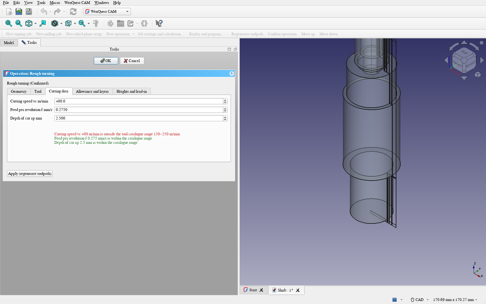
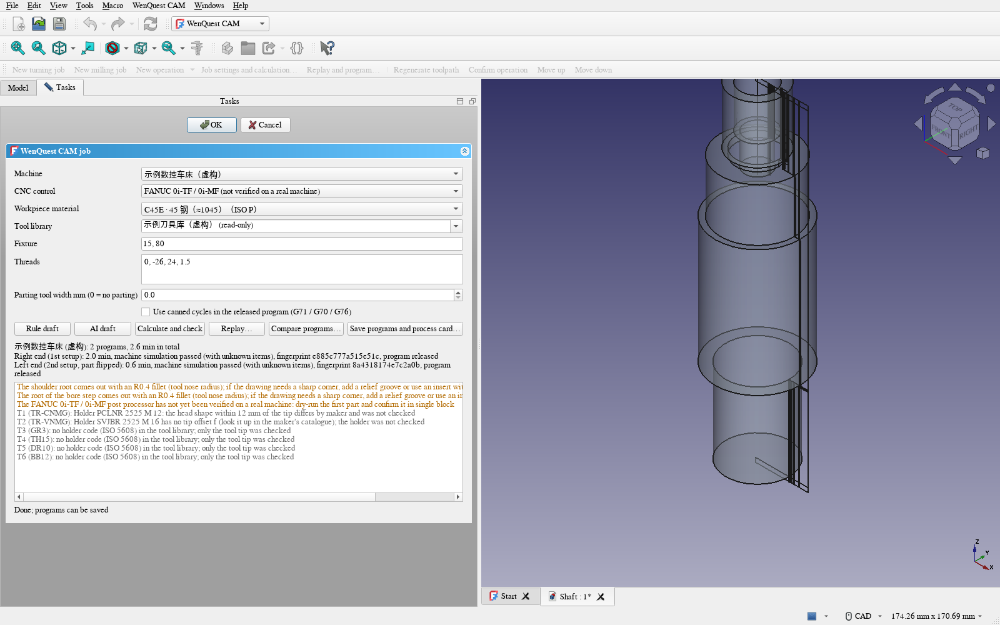
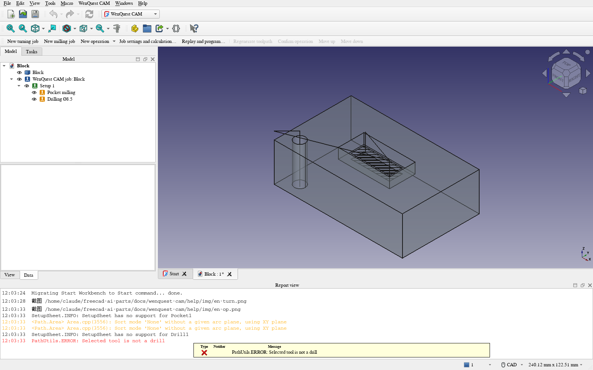
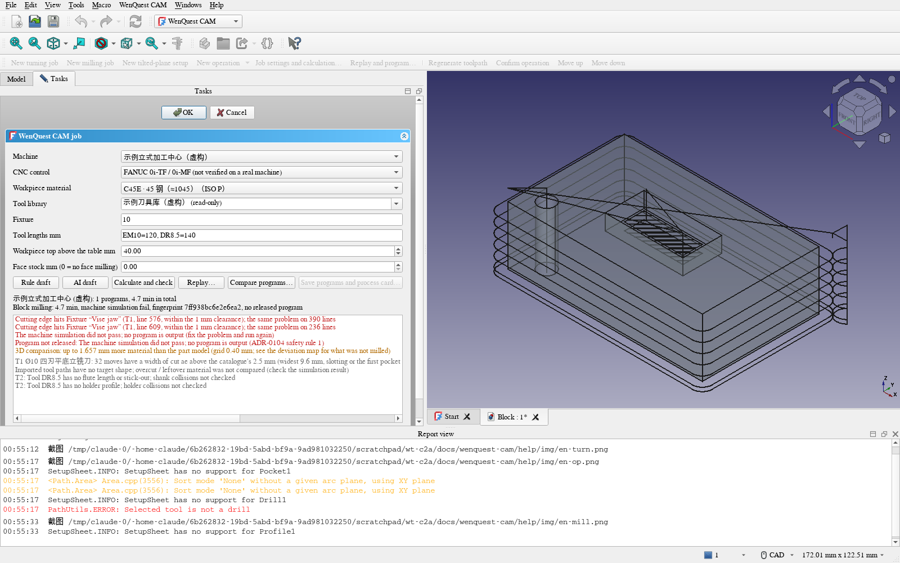
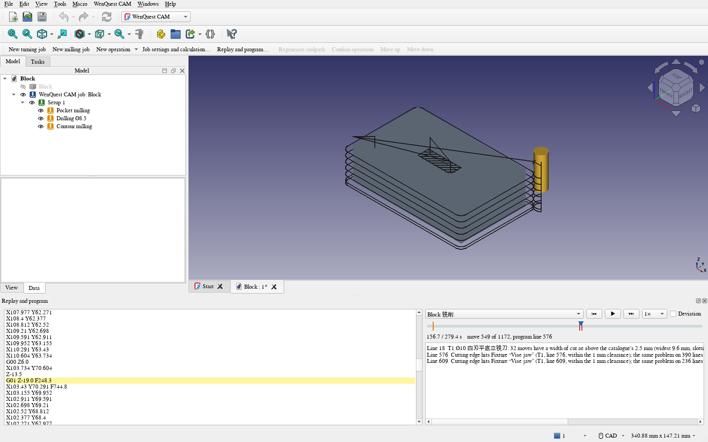
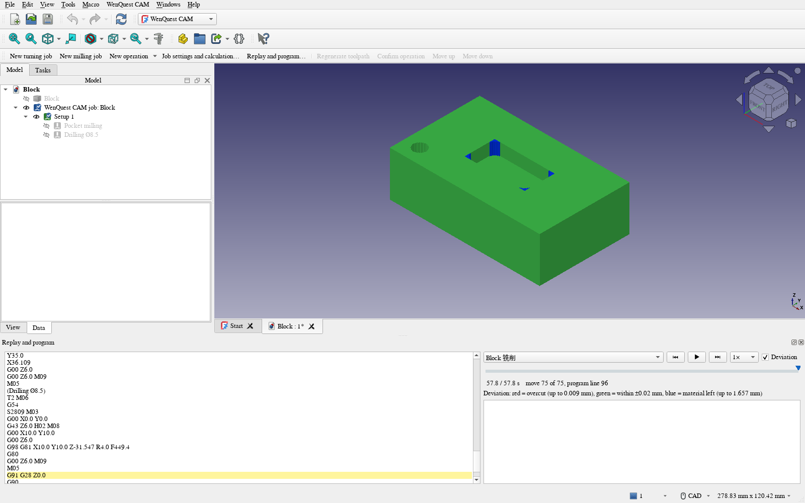
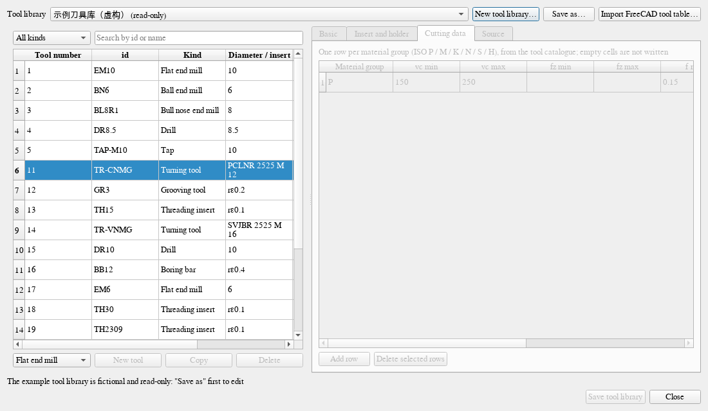
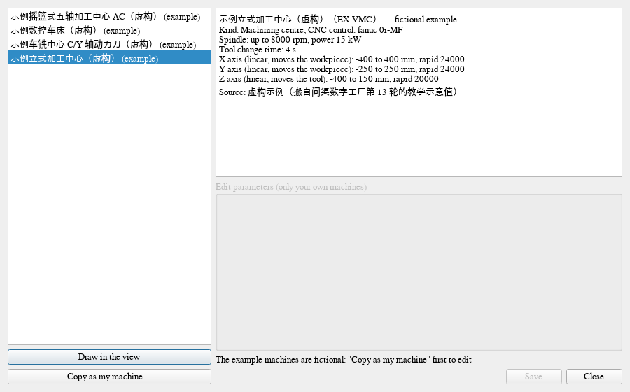
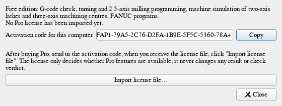

# What WenQuest CAM is

WenQuest CAM is CNC programming software that runs inside FreeCAD. The first edition handles two kinds of parts:

- **Turning**: parts of revolution with grooves, face grooves, internal and external threads (including taper and multi-start threads) and bores (including tapers and arcs), in two setups (right end first, then the part flipped for the left end); bar stock can be parted off;
- **2.5-axis milling**: face milling, pockets (zigzag or adaptive roughing, plus rest machining), contours (arc lead-in and lead-out), chamfers, and holes (drilling, helical hole milling, counterbores, countersinks, tapping, thread milling). Pocket, contour, facing and adaptive paths come from FreeCAD's own CAM; hole and chamfer paths are computed by WenQuest CAM directly from the model.

Three principles run through everything:

1. **AI drafts, the software checks, a person confirms.** The operations and the usable tools are decided by the software from the geometry; the AI (Pro) only picks among the candidate tools and sets cutting data within the ranges of the tool catalogue. Anything outside the ranges is rejected, replaced by the rule value and noted.
2. **Programs are output only after the whole-machine simulation passes.** Every tool path segment moves the machine model and checks the cutting edge, holder, spindle head, fixtures, table and remaining material for collisions, and the axes for overtravel. If anything fails, no program is output.
3. **The written program is read back.** It is compared segment by segment with the simulated tool path; if they differ, no program is output. The program header carries the machine, post processor version, simulation fingerprint and "first part: dry run and single block".

The accuracy of the algorithms is documented in the WenQuest CAM Verification Manual installed with the software: 54 benchmark problems and 61 comparisons (machining time, cutting power, five-axis kinematic round trips, collision tests, removed volume, nose radius, thread root and taper, face grooves, parting off, width of cut, tapping, countersinks, counterbores, thread milling, arc lead-in, ball end mill scallop height, errors that must be reported, post read-back, canned-cycle expansion), all within the stated tolerances.

# Installing and uninstalling

- Windows 10 / 11, 64-bit. Run `WenQuest-CAM-Setup-<version>.exe`. The installer contains FreeCAD 1.0.2 and the Python components it needs.
- The Start menu has WenQuest CAM, this guide, the verification manual (Chinese and English), the getting-started examples and the license notices. The first start opens the "WenQuest CAM" workbench.
- To uninstall, use Windows "Settings → Apps". Your parts, programs and license file are not in the installation folder and are kept.

# The interface: the machining tree

All programming data lives in the FreeCAD document, so it is saved with the file and is still there when you reopen it:

- **Job**: one programming job for one part. It holds the part, the machining type (turning / milling), machine, CNC control, workpiece material, tool library and fixture.
- **Setup**: two for a turned part (right end, then flipped for the left end), one for a milled part.
- **Operation**: rough and finish turning, grooving, face grooving, threading (internal and external), drilling, boring, parting off; face milling, pocket, adaptive roughing, rest machining, contour, chamfer, drilling, helical hole milling, counterbore, countersink, tapping, thread milling. Each operation has its own tool, cutting data, geometry and tool path, drawn as a wireframe in the view.

An operation is either a **draft** (yellow dot on the icon; drafted or newly added) or **confirmed** (checked by a person, cutting data within the tool catalogue ranges). **While any operation is a draft, the job is only simulated; no program is released.**

Double-click the job to open the job panel (task panel on the left); double-click an operation to open its panel. Right-click an operation for: regenerate tool path, confirm, copy, move up / down, hide tool path. "New operation" on the toolbar lists the operation types the current job can take.

# First use: turning a stepped shaft

Use `shaft.step` in `examples\01-shaft-turning` of the installation folder.

1. Open `shaft.step`, select the part in the model tree and press "New turning job" on the toolbar. The outer profile (including tapers and arcs), grooves, face grooves and the bore profile are read, two setups are created and the job panel opens on the left. The part axis must lie along Z, with the right end at the high-Z end.
2. **Threads**: threads are usually not modelled; in the job panel's "Threads" enter one line "Z start, Z end, major diameter, pitch", in the example `0, -26, 24, 1.5`. The thread must start at the end face or in a relief groove, otherwise the program is refused (the tool would hit the part when it starts).
3. Choose the machine, CNC control and workpiece material (a row of the Kienzle table, which selects the group of cutting data in the tool catalogue). For the fixture enter the chuck jaws' "grip length, outer diameter"; the machine simulation checks the tools and holders against the jaws, and the first setup automatically leaves enough stock on the left for the jaws to grip.
4. Press "Rule draft" (Pro also has "AI draft"): 6 operations for the right end and 2 for the left end appear in the model tree, all as drafts.
5. **Confirm each operation**: double-click it; the panel has several tabs — Geometry (the profile read from the part, or picked faces), Tool (only tools usable for this operation), Cutting data (vc, f, ap, with the catalogue ranges beside them); turning operations also have "Allowance and layers" (radial and axial roughing allowance) and "Heights and lead-in" (clearance, retract); 0 means the default. After changing values press "Apply (regenerate toolpath)"; press "OK" to confirm. Values outside the catalogue ranges turn red and cannot be confirmed:

6. Double-click the job and press "Calculate and check": the software runs the cutting simulation (material removal, overcut, leftover material, rapid moves into the stock), the machine simulation, the post processor and the read-back. The panel shows each program's time, the machine simulation result and fingerprint; in the check list red is an error, amber a warning and grey "unknown" (missing data, not checked).

7. Press "Save programs and process card…" and choose a folder: one `.nc` program per setup; Pro also writes the process card and program sheet (Word, PDF).
   The process card has three kinds of drawings: **part drawing** (milling: front, left and top views projected from the part model, hidden lines dashed,
   overall length, width and height; turning: the part outline with step diameters, shoulder positions, overall length, grooves and threads),
   **setup drawing** (one per setup: stock, jaws or fixtures, part, work zero; turning shows clamping length and stick-out) and **tool drawings**
   (each tool drawn from the tool library; turning tools show the insert shape and nose radius). Numbers on the drawings go into the source ledger like
   the numbers in the tables; dimensions missing from the tool library are not drawn, and the card says so (e.g. "T05: no flute length given").
8. **Program comparison**: press "Compare programs…" in the job panel, choose the old and then the new program. The report shows tools added or removed,
   the same path cut with another tool, speed and feed changes per tool (with line numbers), which lines of the tool path differ (maximum deviation,
   first difference) and the time difference. When the two programs only differ in formatting (sequence numbers, comments, decimals, subprograms,
   another control) the report says the tool paths are identical. The report can be saved. Command line:
   `python -m analysis.cam.progdiff old.nc new.nc --machine <machine id>`.

# Turning: bores, face grooves, threads, parting off and canned cycles

- **Bores**: bores with tapers, arcs and chamfers are bored layer by layer along the bore profile, not only by steps.
- **Face grooves**: annular grooves cut axially into an end face are read from the model and get a "Face groove" operation with a face grooving tool.
- **Threads**: each line of the thread table is "Z start, Z end, major diameter, pitch", optionally followed by `in` (internal), `1:16` (taper), `2 starts` (multi-start, indexed by the number of starts) and `R` or `NPT` (taper pipe threads; 1:16 if no taper is given). Examples: R1/2 pipe thread `0, -15, 20.955, 1.814, R`; M30×2 two-start `0, -30, 30, 2, 2 starts`. Thread depth: ISO 68-1 for metric threads, ISO 7-1 for R series (55°, h = 0.640P), ASME B1.20.1 for NPT (h = 0.8P); for taper threads give the major diameter at the start end (Z start).
- **Parting off**: for bar stock enter the tool width in "Parting tool width" in the job panel; the last operation of the first setup parts the part off (half feed near the centre). The jaws grip the bar beyond the part, so the first setup need not leave grip length; if the flipped end would only need a chamfer, the parting tool cuts that chamfer before parting off and no second setup is needed. 0 means the stock is a single blank and is not parted off.
- **Canned cycles**: tick "Use canned cycles in the released program (G71 / G70 / G76)" and FANUC and GSK programs write roughing, finishing and threading as cycles, so they are short; Siemens still gets the expanded moves. Simulation and read-back expand the cycles by the same rule, so what is simulated is what the program will run. Controls differ slightly in how they expand cycles, so the check list carries a warning that canned cycles are not verified on a real machine; run the first part in single block.

# Milling a block

Use `examples\02-block-milling\block.step`.

1. Select the part and press "New milling job" (the part's bounding box is the stock).
2. In the job panel enter the tool lengths (spindle gauge line to tool tip), e.g. `EM10=120, DR8.5=140`, the height of the workpiece top above the table, and the vise grip height as the fixture, e.g. `10`.
3. Press "Rule draft": the pocket gets the largest end mill no larger than half the narrow side of the pocket, the hole a drill of the same diameter. To machine only certain faces, double-click the operation, pick pocket floors or hole walls in the view and press "Use the faces selected in the view"; with nothing picked they are found automatically.
4. Confirm each operation, then press "Calculate and check".

Try again: on the toolbar choose "New operation" → "Contour milling", confirm it and recalculate. A contour milled to the bottom hits the vise jaws: the machine simulation fails, no program is output, and the check list says on which line it hits:

# Milling: holes, facing, chamfers, adaptive roughing, rest machining

- **Holes**: holes along Z are read from the model — through and blind (with drill point), counterbores and countersinks. The rule draft orders them "drill → counterbore → countersink"; when the tool library has no drill of the diameter, the hole is milled helically with a flat end mill.
- **Tapped holes**: threads are usually not modelled. When a hole diameter is exactly the tap drill of a coarse thread (e.g. Ø8.5 for M10, Ø6.8 for M8), the notes in the job panel say "presumably a tapped hole", and **no tapping is added automatically** — if it is to be tapped, add "Tapping" or "Thread milling" under "New operation". Blind holes are tapped to hole depth − 3 pitches, through holes 2 pitches past the bottom; tapping is output as rigid tapping (FANUC M29 + G84, Siemens G331 / G332), and the simulation checks that the core hole is drilled and that feed / speed equals the tap pitch.
- **Face milling**: with a "Face stock" above 0 in the job panel (stock top above the part top), the rule draft starts with face milling: zigzag plus one pass along the edge, with the boundary extended by one tool radius so that the corners are cut.
- **Chamfers**: chamfer faces on the top edges are read from the model; the chamfer mill's cone runs along the chamfer face (tip 0.5 mm below the chamfer bottom, so the tip does not cut). Chamfer mills in the tool library need the cone angle and tip diameter.
- **Contours**: every layer enters and leaves on a quarter arc instead of plunging on the contour.
- **Adaptive roughing** (New operation): FreeCAD's adaptive clearing — small width of cut, deep layers. The simulation measures the actual width of cut move by move and warns when it exceeds 1.5 times the setting.
- **Rest machining** (New operation): an end mill one size smaller than the roughing tool cuts only the material the earlier operations left in the corners.
- **Surface finishing** (New operation): "Surface finishing (parallel)" and "Surface finishing (waterline)" with the largest ball end mill in the library, stepover set for a 0.01 mm scallop. Parallel suits shallow surfaces, waterline steep ones (it does not reach shallow areas). Surface programs are long and take a few minutes to calculate.
- **Allowances and heights**: milling operation panels have "Allowance and layers" (wall and floor allowance) and "Heights and lead-in" (safe height and clearance height, both above the stock top).
- **Depth-of-cut check**: the depth and width of cut of every move are measured in the simulation and compared with the tool catalogue: a depth over the catalogue is an error and no program is output; moves wider than the catalogue width (slotting, the first ring of a pocket) have no catalogue depth, so they are reported as "unknown".

# Replay, program window and deviation map

After calculation press "Replay…" in the job panel (or "Replay and program…" on the toolbar); the replay window opens below the view:

- On the left is the program with the current line highlighted in yellow; click a line and the tool jumps to that move. Clicking a tool path in the view also jumps to the nearest line.
- On the right are play / pause, previous / next move, speed and the timeline. Checks with a line number (collisions, rapid moves into the stock, overtravel…) are marked red on the timeline and listed as events below; click one to jump there, and the tool stops where it collides.
- The in-process stock changes move by move: a height field seen from above for milling, a solid of revolution for turning. Programs that failed the machine simulation and were not output can still be replayed to see where they collide.

Tick "Deviation" to colour the finished stock by its deviation from the part model: **red = overcut, green = within ±0.02 mm, blue = material left**. For milled parts the 3D comparison is also added to the check list: cutting into the part model is an error and no program is output; material left is a warning (for example the sharp inside corners of a pocket, which an end mill cannot reach).

# Machines and tools

- **Tool library window** ("WenQuest CAM" menu → "Tool library…"): view and edit tool libraries. The example library is fictional and read-only; start with "New tool library" or "Save as". A new tool gets an empty template for its kind; insert and holder, cutting data (one row per material group) and source (catalogue and page) are on separate tabs, and empty cells are not written. FreeCAD tool tables can be imported. The library is checked against the format before saving; if something is wrong it is not saved and the field is named. The library then appears in the job panel's "Tool library" list.
  Vendor catalogue libraries are included (read-only, values as in the catalogue with page numbers): ZCC-CT end mills, taps and thread mills; Tungaloy ISO-EcoTurn turning inserts (176, with vc, f and ap ranges per chipbreaker and material group) , ISO metric threading inserts (41 external, 54 internal, picked by pitch) and solid carbide drills (344 DSW drills; holes pick by diameter, the shortest flute that reaches the depth); Kyocera GMM / GMG external grooving inserts (39, with grooving feed and cutting speed per groove width and material group; grooving picks the widest insert that fits the groove, parting the narrowest, full-radius inserts only when nothing else fits; drafting pairs one of 13 Kyocera KGM grooving holders by insert width and groove depth, and a groove deeper than the holder's maximum depth is an error); Kyocera GDM / GDMS cut-off inserts (19) and KGD square-shank cut-off holders (58): parting first picks an insert that gets a holder deep enough (two-edge inserts reach at most 18 mm on deep holders, so larger bars need single-edge GDMS), and grooving never picks a cut-off-only insert (it leaves an uneven groove bottom); plus a Tungaloy holder library (293 external holders, 492 boring bars, 45 threading bars). When a turning tool in the library has no holder, drafting and calculation pair one by insert code (95° holders for C and W inserts, 93° for D and V, 25×25 preferred), so the machine simulation checks the holder shank; internal tools get a boring bar by bore diameter (the drill diameter for boring, the minor diameter for internal threads; the thickest bar that fits; internal threading inserts get a threading bar by insert size), and a bore smaller than the bar's minimum is an error. When drafting turning with a vendor library, roughing picks a chipbreaker with a large catalogue depth of cut and an 80° insert with nose radius up to R0.8; parameters above 80% of the machine power are lowered, not below the catalogue minimum.

- **Machine window** ("WenQuest CAM" menu → "Machines…"): view travel, speeds, tool change time, axis chain and source, and draw the machine in the view; "Copy as my machine", then correct travel, rapids, speed, power and tool change time to the real machine and state the source (maker's document and page, or who measured it and when).

- **Machines**: the four example machines (lathe, vertical machining centre, trunnion five-axis, mill-turn) are fictional and for demonstration only. Before real machining, enter your own machines in `<user folder>\.freecad-ai-parts\machines.yaml` (or the file or folder given by the environment variable `FAP_MACHINES`). The earlier simple format still works; the new format (cam-machine/1) adds the axis chains, rotary centres and component shapes that the machine simulation needs.
- **Tool library**: one JSON file (cam-tool/1); each tool has its kind, diameter or insert, flute length, stick-out, shank diameter, holder profile and the cutting data ranges from the tool catalogue. FreeCAD CAM tool tables (`.fctl`) can be imported; add the holder profile and cutting data afterwards.
- **Internal tools**: tools in a library can be marked "internal" (`internal`) and given a minimum bore (`min_bore_mm`). Drafting picks only internal tools for internal threads and boring, and never for outside operations; calculation reports wrong use and bores smaller than the tool's minimum. Older libraries without the mark work as before.
- **Turning holders**: give the ISO 5608 holder code (e.g. `PCLNR 2525 M 12`) and the tip offset f (from the maker's catalogue) in the tool library, and the machine simulation checks the holder shank against the chuck, tailstock and turret. The head within one insert edge length of the tip differs by maker and is reported as "unknown". Without f the holder is not checked.
- **Nose radius**: the insert nose radius rε is included in the simulation; finish turning, the last roughing pass and finish boring are compensated for rε (computed in WenQuest CAM, without G41/G42, so it works on every control). Shoulder roots come out with an R rε fillet, noted in the check list; if the drawing needs a sharp corner, add a relief groove or use an insert with a smaller nose radius. Facing goes 2rε past the centre so no pip is left.
- **Triangle meshes for machine components**: components in the machine file can be STL meshes (`"mesh": "column.stl"`, relative to the machine file); the machine simulation checks collisions against the mesh, and the simulation fingerprint changes when the mesh file changes.
- Do not invent missing data: leave it out. The related checks then report "unknown" instead of "pass".

# Reading the checks

- **Error (red)**: collisions, overtravel, overcut, rapid moves into the stock, spindle speed over the limit, threading in constant surface speed, milling depth of cut over the tool catalogue, tapping without a core hole or with a feed that does not match the pitch, a thread insert of the wrong form… With a machine simulation error, no program is output.
- **Warning (amber)**: post processor not yet verified on a real machine, cutting power close to the main motor power, etc.
- **Unknown (grey)**: not checked for lack of data, e.g. turning-tool head shapes, holders without an ISO 5608 code or tip offset, missing tool lengths, imported tool paths without a target shape. They do not block the output, but you should know about them.
- **Post configurations**: five are built in — FANUC, Siemens, GSK (lathe), Huazhong HNC-8 and Heidenhain TNC (milling, conversational). Your shop's own style goes into a
  configuration file (JSON, format cam-post/1) in `<user folder>\.freecad-ai-parts\posts\`; it then appears in the job panel's "CNC control" list.
  Switches: program number digits, % before and after, M30 or M02, sequence numbers (start, step), coordinate and feed decimals,
  comments (English, Chinese, none), tool change actions before and after (e.g. `G91 G28 Z0`), M01 between operations, coolant (M08, M07, off),
  G81 / G83 drilling, G71 / G70 / G76 turning, one subprogram per operation. Tool change actions move the machine, so they are included in the
  machine simulation. Whatever the configuration, no program is output without simulation or when the read-back differs from the simulated path,
  and the header still carries "first part: dry run" and "not verified on a real machine" — also with comments set to none. Configurations with
  errors are not listed; hover over the list to see which file and which item.
  Controls that mostly follow FANUC but differ in a few places (Mitsubishi, Mazak, Haas and so on) get a `dialect` section: tool call, speed limit,
  polar / cylindrical interpolation switches, canned-cycle style; every entry needs its source (the maker's official manual: name, document number,
  version, section) or the configuration is refused. Live-tool start lines may contain `{rpm}` (e.g. `M133 P{rpm}`). `checks` records how far the
  configuration has been checked before a real machine (L2 independent interpreter, L3 the maker's control software) and is written into the program
  header; only after a real-machine check is `verified` set and "not verified on a real machine" dropped from the header.
- **Heidenhain (TNC 640 / 620 / 530)**: milling only, conversational format: `BEGIN PGM` … `END PGM`, block numbers from 0; lines `L … R0 F`,
  rapid `FMAX`; tool change `TOOL CALL n Z S rpm`; with drilling cycles on, `CYCL DEF 200` (surface Q203 = R plane − 2 mm, 2nd set-up clearance
  back to the safe height); tapping as `CYCL DEF 207` rigid tapping, each hole called with `M99`; subprograms as `LBL n` … `LBL 0`, called with
  `CALL LBL`; the program ends with an `M140 MB MAX` retract. Tool change actions may only be `M140 MB MAX`, a single M code or an `L … R0 FMAX` line;
  sequence numbers, % and turning items do not apply and are rejected. For read-back the program is converted back to ISO and compared with the
  simulated path. Tool paths contain no arcs (arcs are split into lines at 0.002 mm chord height), so no CC / C blocks are written.
- None of the post processors (FANUC, Siemens, GSK lathe, Huazhong, Heidenhain) has been verified on a real machine yet; the program header says so; programs with canned cycles (turning or drilling) get an extra warning in the check list. **Always dry-run the first part and confirm it in single block.**

# 3+2 tilted planes

On five-axis machining centres (such as the examples EX-5AX-AC, trunnion A and C axes, and EX-5AX-BC, swivel head B and C axes) an operation can work on a tilted working plane: plane origin,
normal (tool axis) and X direction are given in work coordinates, and the operation's tool path uses plane coordinates. Simulation: material removal
uses tri-dexel (any tool axis), and the machine simulation solves the rotary axes from the tool axis and checks overtravel and collisions. Before the
rotary axes turn, Z retracts to machine home; the moves from there to the first plunge follow the control's tilted-plane function and are not
checked by the machine simulation (an "unknown" item in the check list). Posts: FANUC / Huazhong write `G68.2` (plane origin + Z-X-Z Euler angles)
and `G53.1`, cancelled with `G69`; Siemens writes `CYCLE800` (axis-by-axis X, Y, Z, _MODE = 57), cancelled with `CYCLE800()`; Heidenhain writes a
`CYCL DEF 7` datum shift and `PLANE SPATIAL … TURN`, cancelled with `PLANE RESET STAY`. For read-back all three are converted to the same rotation and
compared move by move with the simulated path. Three-axis machines report an error for tilted operations.

In the machining tree: choose a five-axis machine for the milling job (e.g. EX-5AX-AC), click a sloped face of the part in the 3D view and press
"New tilted-plane setup"; a "Tilted plane N" setup appears. Operations added to it (facing, pocket, contour, drilling, holes …) find their features on
that plane, FreeCAD computes the paths in plane coordinates, and the stock is the real stock turned into plane coordinates (a tilted box) — so face
the slope first, then machine the pocket in it. Calculation, replay, 3D comparison and program output work as usual.

# Simultaneous 5-axis

On five-axis machining centres an operation can be simultaneous 5-axis (`simul5`): every move carries a tool axis, and the axis changes continuously
along the cut. Three kinds of tool positions are available (`analysis/cam/fiveaxis.py`): swarf `swarf` (the tool axis follows the rulings and the side of a flat end
mill lies on the surface); ball-end multi-axis surface finishing `ball_surface` (tool axis = surface normal plus lead and tilt angles; the ball stays tangent
to the surface); curve following `curve_follow` (tool axis = surface normal). Functions that take rulings, contact points and normals from FreeCAD faces and
edges are in `freecad_addon/fc/cam_5axis.py`; creating 5-axis operations by picking faces in the machining tree comes in a later version. Zigzag finishing
with a lead angle takes a fixed lead direction (`lead_dir`) so the axis does not reverse at row turns; otherwise run one way with lifts between rows.
Rotary angles are chosen per segment after looking along the whole segment (no switching branch at a travel limit halfway); `avoid_pole` moves the
tool axis a few degrees away from a rotary axis (singularity), and `avoid_collision` tilts it further when the shank or holder would hit the part.
Programs use tool-tip control (RTCP): FANUC / Huazhong write `G43.4 H..` … `G49`, Siemens `TRAORI` … `TRAFOOF`, Heidenhain
`FUNCTION TCPM F TCP AXIS POS PATHCTRL AXIS` … `FUNCTION RESET TCPM`; each block has the tool-tip work coordinates and the rotary angles. Rotary angles
follow a continuous solution along the path (a continuous C axis keeps turning instead of wrapping). GSK controls get no program. Machines without tool-tip control
get machine axis positions (computed point by point from the tool length and work zero, with points inserted where the tip would stray more than 0.01 mm);
the tool length and work zero come from the machine simulation settings and are written in the header: set G54 to 0, no length offset, and post again after
changing the tool length or the setup. Simulation: material removal by tri-dexel (a move whose axis changes is split every 2°), and the machine simulation solves every sample for
overtravel and collisions. The check list may show: a rotary axis turning more than 30° in one cutting move (a singularity was crossed or an axis hit its
travel limit and switched solution) — an error, no program; a tool axis within 1° of a rotary axis (near a singularity) — a warning; a rotary axis needing
more speed than the machine has — a warning that the feed will drop. The move from machine Z home to the first tool position after switching on tool-tip
control is left to the control and not checked ("unknown").
In the machining tree: choose a five-axis machine for the milling job (e.g. EX-5AX-AC), pick faces or edges in the 3D view, then choose "5-axis swarf (ruled face)",
"5-axis surface finishing (ball end mill)" or "5-axis curve following" under New operation. The tool comes from the tool library (swarf needs flutes long enough for
the ruling) with mid-catalogue parameters; lead, tilt, fixed lead direction, singularity avoidance and collision tilting are operation properties — change them and
right-click "Regenerate path". Surface finishing runs parallel lines in plan view and skips places where the ball would cut into neighbouring faces (noted in the
operation's reason). The path wireframe shows short lines along the tool axis; calculation, replay, 3D comparison and program output work as usual.
When a swarf face is a twisted ruled surface (the normal turns along each ruling, as on an S-shaped thin wall), a cylindrical flank cannot fit it exactly: the tool is
offset along the normal at mid-height of each ruling, and positions that would gouge the surface are pushed out, so nothing is overcut at the cost of a little
leftover material there (the operation's reason gives the maximum, about 0.15 mm on the S test piece) for a later rest pass or ball-end multi-axis finishing.
Example: `examples/wenquest-cam/03-cone-5axis` (runs without FreeCAD).

# Mill-turn

On mill-turn centres (such as the example EX-MT-CY: X, Y, Z, C axes, live tools) one program can hold turning operations and live-tool milling:
face milling with polar interpolation `G12.1 … G13.1` (program X is a diameter, C in mm) and cylinder milling with cylindrical interpolation
`G7.1 C radius … G7.1 C0` (C in degrees). The simulation first computes the turned shape, then mills it along the tool axis; times follow the path on
the workpiece. Live-tool and C-axis M codes differ between builders and must be written into the post configuration as `millturn` (from the machine
manual); without them programs with milling are not output. For SINUMERIK the post writes `TRANSMIT` (face; radius programming DIAMOF, X and Y are Cartesian face coordinates) and `TRACYL(working diameter)` (cylinder; Y is the arc length in mm on the working diameter), then `TRAFOOF`, `DIAMON`. Machine simulation solves the C axis from the live-tool directions in the machine file (`live_tools`) and checks collisions; without them it reports "unknown". When a turning job's machine is a mill-turn centre, the "New operation" menu has "Face milling (live tool)" "Cylinder keyway (live tool)" and "Flat slot on cylinder (Y axis)": first pick, in the 3D view, a slot or pocket bottom on an end face (slot or rounded-rectangle pocket) or the bottom of a keyway on the cylinder (semicircular ends, along the axis), then run the command; the operation goes into the right-end or flipped setup according to where the face is. The cutter comes from the tool library by slot width or corner radius, with parameters at the middle of the catalogue range. Calculation appends the live-tool milling after turning and outputs one mill-turn program. Flat slots wider than the cutter use "Flat slot on cylinder (Y axis)": the C axis indexes to the slot and the Y axis mills it (`G00 C angle`, `G19` … `G18`). Slanted slots are not done yet. In the replay the live tool moves at its real position on the workpiece and the in-process stock shows the milled slots.

**B-axis mill-turn centres** (e.g. the example EX-MT-B): turning and milling tools sit in the B-axis spindle. Each turning operation fixes B at one angle:
0° for external tools, 90° for drills and boring bars; when the profile has a down slope that a normal tool cannot reach (steeper than its trailing edge angle),
B is turned automatically so the tool can reach it (the result shows the angle). The program writes the B position and machine X, Z positions without tool offsets,
with the tool length in the header, so every tool needs a length in the machine simulation settings. Live milling is simulated with B positioned (90° on the face,
0° on the cylinder); the milling tool length must be compensated along the tool axis and each control switches this on differently: write `b_tool_comp` in the post configuration's `millturn` (from the machine manual, e.g. `G43.7 H05`); the program writes those lines after the B positioning, and without them no release program is output.
**Twin-spindle mill-turn centres** (e.g. the example EX-MT-TS): when bar stock is parted off and both ends need turning, there is no manual flip — the sub-spindle grips
the finished right end (the cylinder at the right end, grip length from the machine file `sub_spindle.grip_mm`), the part is parted off and the left end is turned on the sub-spindle,
all in one program. The result shows the sub-spindle grip position, grip length and the sub-spindle work zero on the machine. On the sub-spindle Z runs the other way, so program Z is negated
and no canned cycles are used. Spindle sync, clamping and spindle switching differ between makers: fill the seven `twin` entries in the post configuration (from the machine manual).
A too-short end cylinder, a groove or thread in the grip zone, or insufficient sub-spindle travel is reported as an error. Back working needs tools with inserts facing
the sub-spindle: set `back_tools` in the setup (e.g. {"1": 11, "2": 12}: T11 for back roughing, T12 for back finishing) and list those tools in the machine simulation settings.
Machine simulation also checks three things: whether the sub-spindle sweeps into the tool waiting at the tool-change point when it moves in and when it retracts with the part;
whether the sub-spindle chuck is in the way of the parting tool (the parting tool moves along Z at the tool-change X first, then down, and retracts in X first);
and back working, simulated by mirroring the whole machine in Z (sub-spindle chuck and turret travel converted). The release program is output only when all pass and it reads back correctly.
**Two turrets** (e.g. the example EX-MT-TT, whose machine file has `channels`): the upper turret (channel 1) turns the right end on the main spindle while the lower turret (channel 2)
turns the back of the previous part on the sub-spindle; the transfer happens only when both are done (wait points). Two programs are output; the wait instructions come from the post
configuration `channels` (e.g. FANUC `M{n}`, Siemens `WAITM({n},1,2)`, numbered from `wait_first`; without it no programs are output). The channel 2 program waits for the transfer first,
then turns the back and finally unclamps the sub-spindle chuck to unload, so on the first part after start-up channel 2 just waits. The period when both turrets work is checked in 0.05 s steps:
turret against turret, the lower turret against the main-spindle chuck and bar, the upper turret against the sub-spindle chuck and part; any hit and neither program is output.
The result gives the cycle time: cutting, rapid, tool-change and waiting time for each channel, the transfer time (parting + sub-spindle moves), the cycle time = the longer side + transfer,
and how long one turret alone would take for the same part.
**Slopes a turning tool can reach** (all lathes): the approach angle comes from the holder style and the corner angle from the insert shape (Tungaloy catalogue C004),
trailing edge angle = 180° − approach − corner angle; a down slope steeper than the trailing edge angle minus 2°, or a shoulder steeper than the approach angle, is an error.
Unknown holders or inserts give "unknown".

# Feedback

If something goes wrong, choose "Feedback…" in the WenQuest CAM menu: write a few words about what you did and what went wrong, press "Make feedback package…" and choose a folder. A zip is created (your description, versions, a copy of the current document, your tool library / machine / post configurations, the error text; no license file) for you to send to us (WeChat or e-mail). The software never uploads anything by itself.

# Free and Pro

| Free | Pro (license file with `cam_pro`) |
| --- | --- |
| G-code check (time, collisions with the stock, overcut, overtravel, power) | AI process drafting |
| Turning and 2.5-axis milling programming | Post processors other than FANUC (Siemens, GSK) |
| Machine simulation of two-axis lathes and three-axis machining centres | Five-axis and mill-turn machines (later editions) |
| FANUC programs | Process card and program sheet (Word, PDF, Chinese and English) |

The safety checks are identical in both tiers; the free edition does not skip any. To import a license: "WenQuest CAM" menu → "License…".

# AI drafting (Pro)

- "WenQuest CAM" menu → "Set AI key…": DeepSeek in China, Claude elsewhere, switching automatically on errors. The key is stored only on this computer.
- Only part features (diameters, lengths, grooves, threads, holes), the material group and the catalogue ranges of the candidate tools are sent, never the model file.
- The AI's answer is checked item by item: tools that are not candidates, cutting data outside the catalogue ranges, and data without a catalogue range are rejected and replaced by rule values, with a note under the job panel and in the operation's "Reason for the draft".

# Troubleshooting

- **"New turning job" says the axis is not on Z**: rotate the part so its axis lies along Z through the origin, then create the job again.
- **"N operations are still drafts"**: double-click those operations (yellow dot on the icon), check them and press OK to confirm, then calculate again.
- **"No relief groove at the thread start"**: start the thread at the end face, or add a relief groove at the start.
- **"The machine cannot reach: overtravel"**: the tool is too short or the workpiece too low; check the tool lengths and "workpiece top above the table".
- **Machine simulation "passed (with unknown items)"**: look at the grey items and add the missing data (tool lengths, holder profiles).
