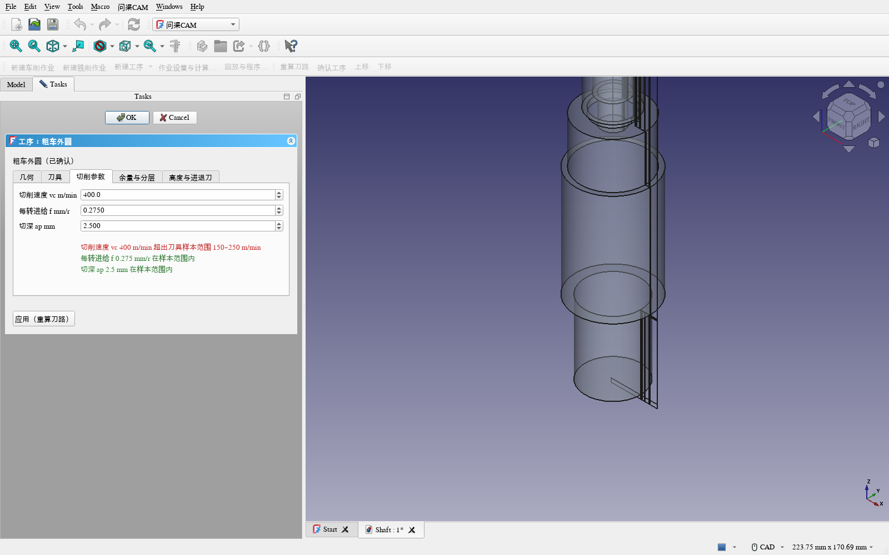
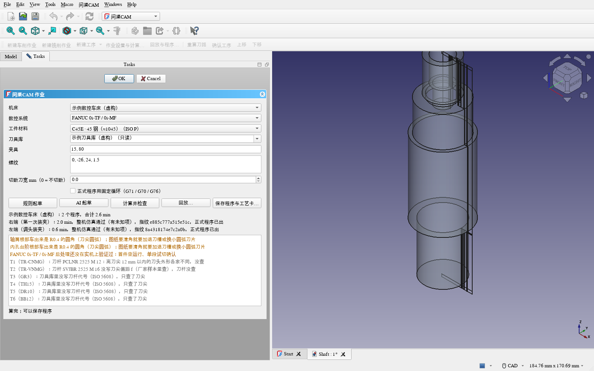
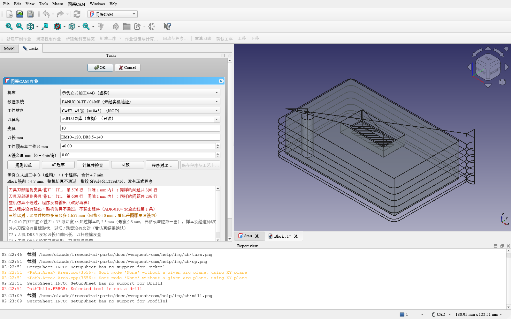
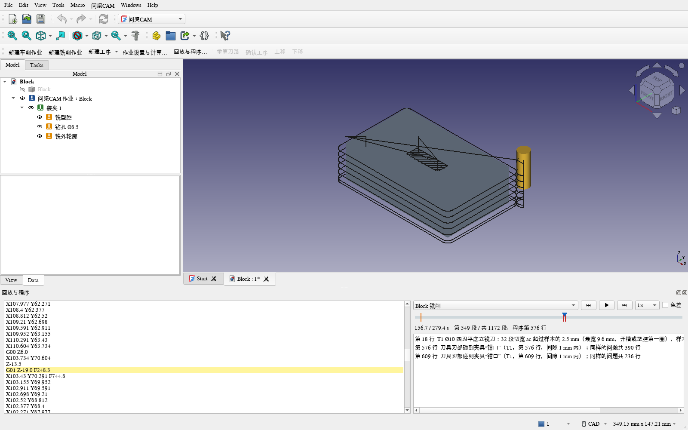
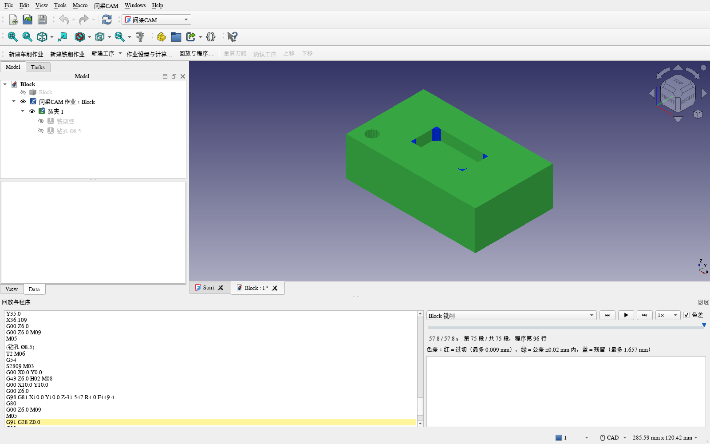
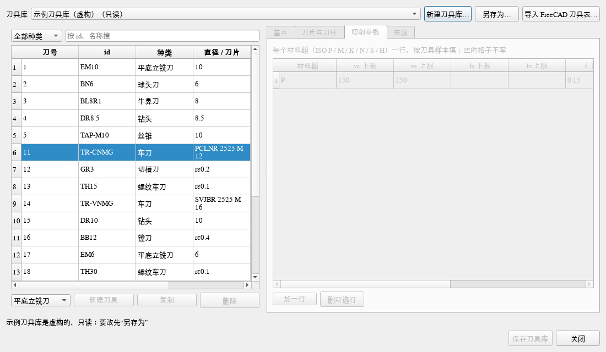
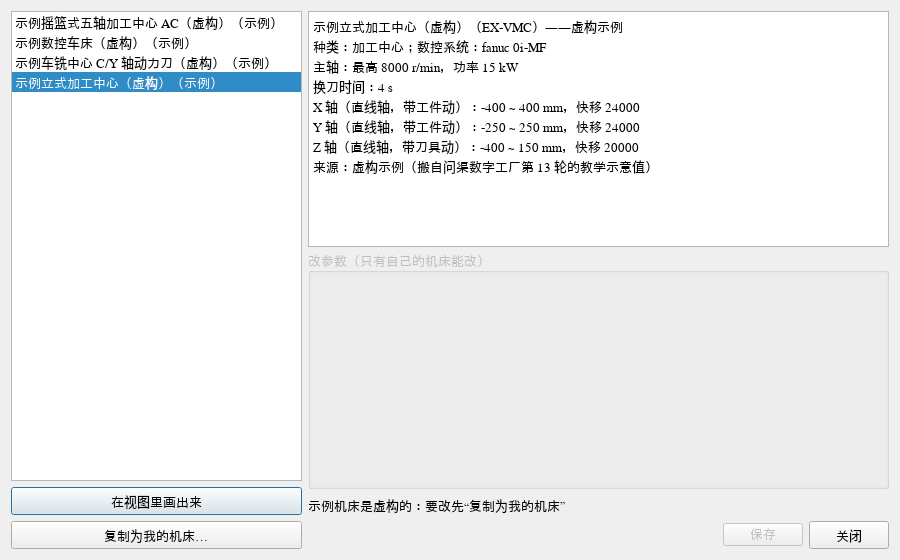
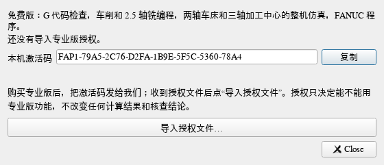

# 问渠CAM 是什么

问渠CAM 是装在 FreeCAD 里的数控编程软件。第一版做两类零件：

- **车削**：阶梯轴、带槽、带端面槽、带内外螺纹（含锥螺纹、多头螺纹）、带内孔（含锥孔、圆弧）的回转体，两次装夹（先车右端，调头车左端），棒料可以车完切断；
- **2.5 轴铣**：面铣、型腔（之字形或自适应开粗，加残料清角）、外轮廓（圆弧切入切出）、倒角，孔（钻、螺旋铣孔、铣沉孔、锪孔口、攻丝、铣螺纹）。型腔、外轮廓、面铣、自适应的刀路由 FreeCAD 自带的 CAM 算，孔、倒角的刀路由问渠CAM 按模型直接算。

三条原则贯穿全部功能：

1. **AI 起草，程序核对，人确认。** 工序和能用的刀由程序按几何条件定；AI（专业版）只在候选刀里挑、只在刀具样本给的范围里定切削参数；超出范围的一律不采用，改用规则值并写明。
2. **整台机床仿真通过才出程序。** 每段刀路都按机床模型把机床动起来，查刀具、刀柄、主轴头、夹具、工作台、剩下的材料是否相碰，以及超程。有一项不通过，程序就不输出。
3. **程序出来再回读一遍。** 写好的程序读回来，与仿真用的刀路逐段比对，对不上也不输出。程序头写着机床、后处理版本、仿真指纹和“首件须空运行、单段试切确认”。

算法的准确性见随软件安装的《问渠CAM 验证手册》：54 道标准题、61 项对照（加工时间、切削功率、五轴运动学往返、碰撞判断、去除体积、刀尖圆弧、螺纹牙底与锥度、端面槽、切断、切宽、攻丝、锪孔口、沉孔、铣螺纹、圆弧切入、球头刀残留高度、必须报出的错误、后处理回读、固定循环展开），全部在注明的误差内。

# 安装与卸载

- 系统：Windows 10 / 11，64 位。运行 `WenQuest-CAM-Setup-<版本>.exe`，按提示安装。安装包里已经带了 FreeCAD 1.0.2 和需要的 Python 组件。
- 开始菜单里有“问渠CAM”、用户手册、验证手册（中英）、入门例子和许可证说明。第一次启动直接进入“问渠CAM”工作台。
- 卸载：Windows“设置 → 应用”里找到 WenQuest CAM。你的零件、程序和授权文件不在安装目录里，卸载不会删掉。

# 界面：加工树

问渠CAM 的编程数据都放在 FreeCAD 文档里，存盘就存下，下次打开还在：

- **作业**：一个零件的一次编程。记着零件、加工方式（车 / 铣）、机床、数控系统、工件材料、刀具库、夹具。
- **装夹**：车削件两次（右端、调头车左端），铣削件一次。
- **工序**：粗车、精车、切槽、端面槽、车螺纹（内外）、钻孔、镗孔、切断；面铣、铣型腔、自适应开粗、残料清角、铣外轮廓、倒角、钻孔、螺旋铣孔、铣沉孔、锪孔口、攻丝、铣螺纹。每道工序有自己的刀、切削参数、几何和刀路，视图里画出它的刀路线框。

工序有两种状态：**草稿**（图标带黄点，起草或新建出来的）和**已确认**（人看过、参数在刀具样本范围内）。**还有草稿工序时只仿真，不出正式程序。**

双击作业打开作业面板（左边任务栏）；双击工序打开工序面板。右键工序：重算刀路、确认、复制、上移 / 下移、隐藏刀路。工具栏的“新建工序”下拉列出当前作业能加的工序类型。

# 第一次用：车一根阶梯轴

用安装目录 `examples\01-shaft-turning` 里的 `shaft.step`。

1. 打开 `shaft.step`，在模型树里选中零件，按工具栏“新建车削作业”。外圆轮廓（含锥面、圆弧）、槽、端面槽、内孔轮廓自动读出，建好两次装夹，左边打开作业面板。零件的轴线要沿 Z，右端在 Z 大的一头。
2. **螺纹**：模型上一般不画螺纹，在作业面板“螺纹”里手填一行“Z 起, Z 止, 大径, 螺距”，例子里是 `0, -26, 24, 1.5`。螺纹起刀处要在端面或退刀槽里，否则程序拒绝（起刀会撞工件）。
3. 选机床、数控系统、工件材料（Kienzle 表的材料行，决定用刀具样本里哪一组参数）。夹具填卡爪的“夹持长度, 外径”；整机仿真按卡爪查刀和刀杆会不会碰，第一次装夹自动在毛坯左端留够卡爪夹的长度。
4. 按“规则起草”（专业版还可以按“AI 起草”）：右端 6 道、左端 2 道工序建在模型树里，都是草稿。
5. **逐道确认**：双击工序，面板分几页——几何（读出的轮廓或点选的面）、刀具（只列这道工序能用的刀）、切削参数（vc、f、ap，旁边写着刀具样本的范围）；车削工序还有“余量与分层”（粗车径向、轴向余量）和“高度与进退刀”（安全距离、退刀量），填 0 用缺省值。改了参数按“应用（重算刀路）”；按“OK”记为已确认。参数超出样本范围会变红，不能确认：

6. 双击作业，按“计算并检查”：程序做切削仿真（材料去除、过切、残留、快移撞料）、整机仿真、后处理、回读比对。面板上写着每个程序的时间、整机仿真结论和指纹；下面的检查清单里，红色是错误、黄色是提示、灰色是“未知”（缺数据、没查的）。

7. 按“保存程序与工艺卡…”，选一个文件夹：每次装夹一个 `.nc` 程序；专业版再出工艺卡与程序单（Word、PDF）。
   工艺卡里有三种图：**零件图**（铣：零件模型投影出的主视、左视、俯视三视图，看不见的线画虚线，标总长、总宽、总高；车：零件外形，标各段直径、轴肩位置、总长、槽和螺纹）、
   **装夹图**（每次装夹一张：毛坯、卡爪或夹具、零件、工件零点，车削标夹持长度和伸出长度）、**刀具图**（每把刀按刀具库的尺寸画，车刀画刀片形状和刀尖圆弧）。
   图上的数和表里的数一样记进出处账；刀具库没写的尺寸不画不标，图下写明“T05：没写刃长”之类。
8. **程序对比**：作业面板按“程序对比…”，先选旧版、再选新版程序，报告写两版差在哪：加了 / 去了哪把刀、同样的刀路换了刀、
   哪把刀的转速、进给改了多少（各在第几行）、哪几行刀路不同（最大偏差多少、第一处在哪）、时间差。两版只是写法不同
   （顺序号、注释、小数位、子程序、换了数控系统）时报“刀路相同”。报告可以存成文件。命令行：`python -m analysis.cam.progdiff 旧.nc 新.nc --machine 机床号`。

# 车削：内孔、端面槽、螺纹、切断与固定循环

- **内孔**：内孔是锥面、圆弧、倒角的，按内轮廓分层镗，不只按台阶。
- **端面槽**：模型上的端面槽（沿 Z 向切进端面的环形槽）自动读出，建“端面槽”工序，用端面槽刀。
- **螺纹**：螺纹表每行“Z 起, Z 止, 大径, 螺距”，后面可以加：`内`（内螺纹）、`1:16`（锥螺纹，按锥度）、`2 头`（多头，按头数分度起刀）、`R` 或 `NPT`（锥管螺纹，不写锥度就按 1:16）。例如 R1/2 管螺纹 `0, -15, 20.955, 1.814, R`，M30×2 双头 `0, -30, 30, 2, 2 头`。牙高：普通螺纹按 ISO 68-1，R 系列按 ISO 7-1（55°，h = 0.640P），NPT 按 ASME B1.20.1（h = 0.8P）；锥螺纹的大径写起刀端（Z 起）的大径。
- **切断**：毛坯是棒料时，在作业面板“切断刀宽”填刀宽，第一次装夹最后一道是切断（快到中心进给减半）；卡爪夹在零件左边的棒料上，第一次装夹不用给卡爪留夹持长度；调头那边如果只剩左端一个倒角，就在切断前用切断刀倒，不再调头。填 0 表示毛坯就是单件料，不切断。
- **固定循环**：勾“正式程序用固定循环（G71 / G70 / G76）”，FANUC、广数的程序里粗精车、车螺纹写成循环，程序短；西门子照样出直线段。仿真和回读比对都按同一条展开规则把循环展开成直线段，所以仿真看到的就是程序会走的。数控系统自己怎么展开循环各家略有不同，检查清单里有一条“固定循环未经实机验证”的提示，首件单段走一遍。

# 铣一个块

用 `examples\02-block-milling\block.step`。

1. 选中零件，按“新建铣削作业”（零件包围盒当毛坯）。
2. 作业面板里填刀长（主轴端面到刀尖），例如 `EM10=120, DR8.5=140`；填工件顶面离工作台的高度；夹具填平口钳的夹持高度，例如 `10`。
3. 按“规则起草”：铣型腔取刀径不超过型腔窄边一半的最大立铣刀，孔取直径相同的钻头。想只加工某几个面，双击工序，在视图里点选型腔底面或孔壁，按“用视图里选中的面”；不点选就自动找。
4. 逐道确认后按“计算并检查”。

再试一次：工具栏“新建工序”→“铣外轮廓”，确认后再算。铣到底的外轮廓会撞平口钳的钳口，整机仿真不通过，程序不输出，检查清单写明撞在哪一行：

# 铣削：孔、面铣、倒角、自适应开粗、残料清角

- **孔**：模型里沿 Z 的孔自动读出——通孔、盲孔（含钻尖）、沉孔、锪孔口。规则起草按“钻孔 → 铣沉孔 → 锪孔口”排；刀具库里没有这个直径的钻头时，用平底立铣刀螺旋铣孔。
- **螺纹孔**：模型上一般不画螺纹。孔径正好是粗牙螺纹的攻丝底孔（例如 Ø8.5 是 M10、Ø6.8 是 M8）时，作业面板的说明里写“推测是螺纹孔”，**不自动攻丝**——确认要攻丝，就在“新建工序”里加“攻丝”或“铣螺纹”。盲孔攻到孔深 − 3 个螺距，通孔攻出底面 2 个螺距；攻丝出刚性攻丝（FANUC M29 + G84，西门子 G331 / G332），仿真查底孔有没有钻到、进给与转速之比是不是丝锥螺距。
- **面铣**：作业面板“面铣余量”大于 0（毛坯顶面高出零件顶面），规则起草第一道是面铣：之字形加沿边一圈，边界往外放一个刀具半径，四个角都铣到。
- **倒角**：模型顶边的倒角面自动读出，倒角刀的锥面贴着倒角面走（刀尖比倒角底边低 0.5 mm，不用刀尖切）。刀具库里倒角刀要写锥角和刀尖直径。
- **外轮廓**：每层都用四分之一圆弧切入、切出，不在轮廓上直接下刀。
- **自适应开粗**（新建工序）：FreeCAD 的自适应清料，切宽小、每层切得深。仿真逐段量出实际切宽，超过设定值 1.5 倍会提示。
- **残料清角**（新建工序）：用比开粗刀小一号的立铣刀，只铣前面工序在转角留下的料。
- **曲面精铣**（新建工序）：“曲面平行精铣”“曲面等高精铣”，用刀具库里最大的球头刀，行距按残留高度 0.01 mm 算。平行适合平缓的曲面，等高适合陡面（平缓的地方等高铣不到）。曲面程序很长，计算要几分钟。
- **余量与高度**：铣工序的面板里有“余量与分层”（侧壁、底面余量）和“高度与进退刀”（安全高度、快移高度，都从毛坯顶面算起）。
- **切深核对**：每一段走刀的切深、切宽都在仿真里量出来，与刀具样本比：切深超过样本是错误，程序不输出；开槽、型腔第一圈这类切宽超过样本的段，样本没给这种切宽下的切深，报“未知”。

# 回放、程序窗口与色差

算完以后按作业面板的“回放…”（或工具栏“回放与程序…”），视图下方打开回放窗口：

- 左边是程序，当前行黄色高亮；点哪一行，刀具就跳到那一段。在视图里点工序的刀路，也跳到最近的那一行。
- 右边是播放 / 暂停、上一段 / 下一段、速度和时间轴。检查清单里带行号的问题（碰撞、快移撞料、超程……）在时间轴上标红，下面列成事件，点一下跳过去，视图里刀具就停在撞的位置。
- 在制毛坯跟着刀具一段段变：铣削画成从上往下看的高度场，车削画成回转面。整机仿真不通过、没出正式程序时，照样能回放，看是在哪里撞的。

勾上“色差”，加工完的毛坯按与零件模型的偏差上色：**红 = 过切，绿 = 在 ±0.02 mm 内，蓝 = 多留的材料**。铣削件还会把三维比对的结论写进检查清单：切进零件模型是错误、程序不输出；多留的料是提示（例如型腔的直角转角，立铣刀铣不到）。

# 机床和刀具

- **刀具库窗口**（“问渠CAM”菜单 →“刀具库…”）：看、改刀具库。示例刀具库是虚构的、只读，先“新建刀具库”或“另存为”自己的；新建刀具按种类给空模板，刀片与刀杆、切削参数（每个材料组一行）、来源（样本名称和页码）分页填，空的格子不写进文件；能导入 FreeCAD 刀具表。保存前按刀具库格式核对，填错了不存、写明哪一项。作业面板的“刀具库”下拉里就能选到。
  随附两份厂商样本刀具库（只读，参数照样本、逐把注明页码）：株洲钻石的立铣刀、丝锥、螺纹铣刀；泰珂洛 ISO-EcoTurn 车刀片（176 种，按断屑槽给各材料组的 vc、f、ap 范围）和 ISO 米制螺纹刀片（外螺纹 41 种、内螺纹 54 种，按螺距挑）；另有泰珂洛外圆刀杆库（293 把）。刀具库里的车刀没写刀杆时，起草和计算按刀片代号从刀杆库配一把（C、W 形配 95° 刀杆，D、V 形配 93°，截面优先 25×25），整机仿真就能查刀杆柄部碰撞。用厂商库起草车削时，粗车挑样本切深大的断屑槽、刀尖圆弧不大于 R0.8 的 80° 刀片，参数超出机床功率的 80% 时自动降到样本下限以内。

- **机床窗口**（“问渠CAM”菜单 →“机床…”）：看机床的行程、转速、换刀时间、轴链、来源，在视图里画出机床外形；“复制为我的机床”后按实机改行程、快移、转速、功率、换刀时间，写明来源（厂家资料页码或谁哪天测的）。

- **机床**：仓库里的四台示例机床（车床、立式加工中心、摇篮式五轴、车铣中心）都是虚构的，只用来演示。用于真实加工前，把自己的机床写进 `用户目录\.freecad-ai-parts\machines.yaml`（或环境变量 `FAP_MACHINES` 指定的文件或文件夹）。以前填的简单格式照常能用；新格式（cam-machine/1）多了轴链、回转中心、部件外形，整机仿真靠它。
- **刀具库**：一个 JSON 文件（cam-tool/1），每把刀写种类、直径或刀片、刃长、伸出、柄径、刀柄外形和刀具样本给的切削参数范围。FreeCAD CAM 的刀具表（`.fctl`）可以导入，导入后补上刀柄外形和切削参数。
- **内孔刀**：刀具库里的刀可以标“内孔用”（`internal`）和“最小孔径”（`min_bore_mm`）。起草时内螺纹、镗孔只挑内孔刀，外圆工序不挑；计算时用错了、孔比刀的最小孔径小，都报错。没标内外的老刀具库照旧。
- **车刀刀杆**：在刀具库里写 ISO 5608 刀杆代号（例如 `PCLNR 2525 M 12`）和刀尖偏距 f（厂家样本里查），整机仿真就查刀杆柄部碰卡盘、尾座、刀塔；离刀尖一个刀片刃长以内的刀头各家形状不同，报“未知”。没写 f 的，刀杆不查。
- **刀尖圆弧**：车刀刀片的刀尖圆弧半径 rε 计入仿真；精车、粗车最后一刀、精镗按 rε 补偿（在问渠CAM 里算好，不用 G41/G42，哪种系统都一样）。轴肩根部车出来是 R rε 的圆角，检查清单里有一条提示；图纸要清角就加退刀槽或换小圆弧刀片。车端面车过中心 2rε，中心不留凸台。
- **机床部件的三角网格**：机床文件里部件可以写 STL 网格（`"mesh": "立柱.stl"`，相对机床文件的路径），整机仿真按网格查碰撞；网格文件改了，仿真指纹跟着变。
- 缺的数据不要编：不写就行，相关检查会报“未知”，不会当成“通过”。

# 安全检查怎么看

- **错误（红）**：碰撞、超程、过切、快移撞料、转速超限、车螺纹时还是恒线速、铣削切深超出刀具样本、攻丝前没钻底孔或进给与螺距不符、螺纹刀片牙型不对……整机仿真有错误时程序不输出。
- **提示（黄）**：后处理还没在实机上验证、切削功率接近主电机功率等。
- **未知（灰）**：缺数据没查的，例如车刀刀头外形、没写刀杆代号或刀尖偏距、刀长没填、外来刀路没有目标形状。它们不挡程序输出，但要你心里有数。
- **后处理配置**：内置 FANUC、西门子、广数（车）、华中 HNC-8、海德汉 TNC（铣，对话格式）五份。车间自己的写法写成一份配置文件（JSON，格式 cam-post/1），
  放 `用户目录\.freecad-ai-parts\posts\`，作业面板“数控系统”下拉里就能选到。能改的开关：程序号位数、前后 %、M30 或 M02，
  顺序号（起始、步长），坐标和进给小数位，注释（英文、中文、不写），换刀前后动作（例如 `G91 G28 Z0`）、工序间 M01，冷却（M08、M07、不开），
  钻孔用 G81 / G83，车削用 G71 / G70 / G76，每道工序一个子程序。换刀前后动作会动机床，也进整机仿真。不管怎么配，没仿真不出程序、
  回读和仿真刀路对不上不出程序、程序头的“首件空运行”“未经实机验证”照样写——注释选“不写”也一样。配置写错的不列进下拉，鼠标停在下拉上能看到哪个文件哪一项错。
- **海德汉（TNC 640 / 620 / 530）**：只出铣的程序，对话格式：`BEGIN PGM` … `END PGM`，每段段号从 0 起；直线 `L … R0 F`，快移 `FMAX`；
  换刀 `TOOL CALL 号 Z S转速`；钻孔循环打开时写 `CYCL DEF 200`（表面坐标 Q203 = R 平面 − 2 mm，第二安全距离回到安全高度），
  攻丝写 `CYCL DEF 207` 刚性攻丝，每个孔 `M99` 调用；子程序写成 `LBL 号` … `LBL 0`，主程序 `CALL LBL`；程序结束 `M140 MB MAX` 退刀。
  换刀前后动作只能写 `M140 MB MAX`、单独的 M 代码或 `L … R0 FMAX` 直线；顺序号、%、车削项对海德汉不适用，打开会被拒。
  回读时把对话格式换回 ISO 再与仿真刀路逐段比。刀路里没有圆弧（圆弧已按弦高 0.002 mm 拆成直线），所以不写 CC / C。
- 现有后处理（FANUC、西门子、广州数控车、华中、海德汉）都还没在实机上验证，程序头写着“未经实机验证”；用了固定循环（车削循环、钻孔循环）的，检查清单另有一条提示。**首件一定空运行、单段试切。**

# 3+2 倾斜面

五轴加工中心（如示例机床 EX-5AX-AC，摇篮式 A、C 轴；EX-5AX-BC，摆头式 B、C 轴）上，工序可以在倾斜的工作平面上加工：平面原点、法向（刀轴）、X 方向用工件坐标给，
这道工序的刀路用平面坐标。仿真：材料去除改用三向 dexel（任意刀轴），整机仿真按刀轴方向逆解回转轴，查超程与碰撞；
转回转轴前先把 Z 退到机床原点，转完到第一次下刀那几段由数控系统的倾斜面功能走，整机仿真没查，检查清单里有一条“未知”。
后处理：FANUC / 华中写 `G68.2`（平面原点 + Z-X-Z 欧拉角）+ `G53.1`，工序结束 `G69`；西门子写 `CYCLE800`（逐轴旋转 X、Y、Z，_MODE = 57），
结束 `CYCLE800()`；海德汉写 `CYCL DEF 7` 零点平移 + `PLANE SPATIAL … TURN`，结束 `PLANE RESET STAY`。三种写法回读时都换回同一个旋转，与仿真刀路逐段比。
三轴机床遇到倾斜面工序直接报错。

在加工树里用：铣削作业的机床选五轴（如 EX-5AX-AC），在三维视图里点零件上的斜面，按工具栏“新建倾斜面装夹”，加工树里多一个“倾斜面 N”装夹；
在这个装夹里“新建工序”（面铣、型腔、外轮廓、钻孔、孔……）时，特征按这个平面找，刀路由 FreeCAD 在平面坐标里算，毛坯是真实毛坯转到平面坐标里的斜放长方体
（所以先面铣把斜面铣出来，再铣斜面上的型腔）。计算、回放、三维比对、出程序与平常一样。

# 车铣复合

车铣中心（如示例机床 EX-MT-CY：X、Y、Z、C 轴，动力刀）上，一个程序里可以有车削工序和动力刀铣削工序：端面铣用极坐标插补 `G12.1 … G13.1`
（程序 X 直径、C 毫米），圆柱面铣用圆柱插补 `G7.1 C 半径 … G7.1 C0`（C 是角度）。仿真先按车削算出车完的外形，再在上面按刀轴铣；时间按工件上的路程算。
开动力刀、切 C 轴的 M 代码各厂不同，要在后处理配置里写 `millturn`（按机床说明书）；没写时带铣削段的程序不出。西门子系统写成 `TRANSMIT`（端面，半径编程 DIAMOF，X、Y 是端面直角坐标）和 `TRACYL(工作直径)`（圆柱面，Y 是工作直径上展开的弧长 mm），完了 `TRAFOOF`、`DIAMON`。整机仿真按机床文件里动力刀的朝向（`live_tools`）算 C 轴、查碰撞；机床文件没写时报“未知”。车削作业的机床选车铣中心后，菜单“新建工序”里有“端面铣（动力刀）”“圆柱面键槽（动力刀）”“圆柱面平底槽（Y 轴）”：先在三维视图里点端面上的槽底或型腔底（长圆槽、圆角矩形型腔），或圆柱面上键槽的底面（两端半圆、沿轴向），再点这个命令，工序按面的位置加到右端或调头装夹里；刀按槽宽、圆角从刀具库里挑，参数取样本范围的中间值。计算时车削之后接动力刀铣削，出一个车铣程序。比刀宽的平底槽用“圆柱面平底槽（Y 轴）”：C 轴分度到槽底朝向后，用 Y 轴铣（程序 `G00 C 角度`、`G19` … `G18`）。斜着的槽还不做。回放里铣削段的刀按工件上的真实位置走，在制毛坯显示铣出来的槽。

# 问题反馈

出了问题，在问渠CAM 菜单里点“问题反馈…”：写几句做了什么、哪里不对，点“生成反馈包…”选一个文件夹，生成一个 zip（你写的话、版本、当前文档副本、你的刀具库 / 机床 / 后处理配置、报错文字；不含授权文件），自己发给我们（微信或邮件）。软件不会自动上传任何东西。

# 免费版与专业版

| 免费版 | 专业版（授权文件里有 `cam_pro`） |
| --- | --- |
| G 代码检查（时间、撞料、过切、超程、功率） | AI 起草工艺 |
| 车削、2.5 轴铣编程 | FANUC 以外的后处理（西门子、广数） |
| 两轴车床、三轴加工中心的整机仿真 | 五轴、车铣复合机床（后续版本） |
| FANUC 程序 | 工艺卡与程序单（Word、PDF，中英） |

安全检查两档完全一样，免费版不少查一项。导入授权：“问渠CAM”菜单 →“授权…”。

# AI 起草（专业版）

- “问渠CAM”菜单 →“设置 AI 密钥…”：中国用 DeepSeek，其他地方用 Claude，出错自动换另一家。密钥只存在本机。
- 发给 AI 的只有零件特征（直径、长度、槽、螺纹、孔）、材料组和候选刀具的样本范围，不发模型文件。
- AI 的回答逐项核对：不是候选的刀、超出样本范围的参数、样本没给范围的参数都不采用，改用规则值，写在作业面板下面的说明和工序的“起草理由”里。

# 常见问题

- **“新建车削作业”报轴线不在 Z 轴上**：把零件转成轴线沿 Z、过原点再建。
- **“还有 N 道工序是草稿”**：双击这些工序（图标带黄点），核对后按 OK 确认，再算。
- **“螺纹起刀处没有退刀槽”**：螺纹从端面车起，或者在起刀处加一个退刀槽。
- **“机床走不到：超程”**：刀太短或工件放得太低，检查刀长和“工件顶面离工作台”。
- **整机仿真“通过，有未知项”**：看灰色的那几条，补上数据（刀长、刀柄外形）就会变成“通过”。
