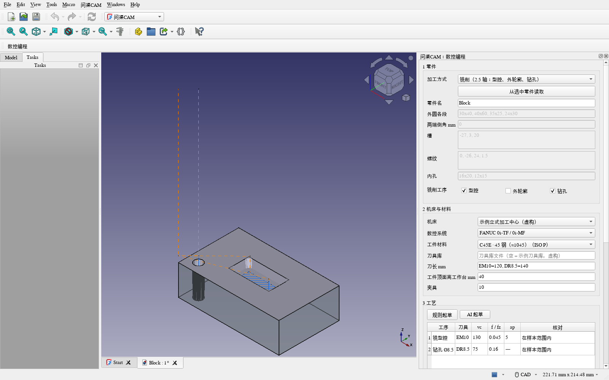

# 问渠CAM 是什么

问渠CAM 是装在 FreeCAD 里的数控编程软件。第一版做两类零件：

- **车削**：阶梯轴、带槽、带外螺纹、带内孔的回转体，两次装夹（先车右端，调头车左端）；
- **2.5 轴铣**：型腔、外轮廓、钻孔，刀路由 FreeCAD 自带的 CAM 算。

三条原则贯穿全部功能：

1. **AI 起草，程序核对，人确认。** 工序和能用的刀由程序按几何条件定；AI（专业版）只在候选刀里挑、只在刀具样本给的范围里定切削参数；超出范围的一律不采用，改用规则值并写明。
2. **整台机床仿真通过才出程序。** 每段刀路都按机床模型把机床动起来，查刀具、刀柄、主轴头、夹具、工作台、剩下的材料是否相碰，以及超程。有一项不通过，程序就不输出。
3. **程序出来再回读一遍。** 写好的程序读回来，与仿真用的刀路逐段比对，对不上也不输出。程序头写着机床、后处理版本、仿真指纹和“首件须空运行、单段试切确认”。

算法的准确性见随软件安装的《问渠CAM 验证手册》：17 道标准题、24 项对照（加工时间、切削功率、五轴运动学往返、碰撞判断、去除体积、螺纹牙底、必须报出的错误、后处理回读），全部在注明的误差内。

# 安装与卸载

- 系统：Windows 10 / 11，64 位。运行 `WenQuest-CAM-Setup-<版本>.exe`，按提示安装。安装包里已经带了 FreeCAD 1.0.2 和需要的 Python 组件。
- 开始菜单里有“问渠CAM”、用户手册、验证手册（中英）、入门例子和许可证说明。第一次启动直接进入“问渠CAM”工作台。
- 卸载：Windows“设置 → 应用”里找到 WenQuest CAM。你的零件、程序和授权文件不在安装目录里，卸载不会删掉。

# 第一次用：车一根阶梯轴

用安装目录 `examples\01-shaft-turning` 里的 `shaft.step`。

1. 打开 `shaft.step`，按工具栏上的“数控编程”，右边出现面板，从上到下五块：零件、机床与材料、工艺、计算并检查、输出。
2. **零件**：加工方式选“车削”。在模型树里选中零件，按“从选中零件读取”——外圆各段、槽、内孔自动填好。零件的轴线要沿 Z，右端在 Z 大的一头。
3. **螺纹**：模型上一般不画螺纹，手填一行“Z 起, Z 止, 大径, 螺距”，例子里是 `0, -26, 24, 1.5`。螺纹起刀处要在端面或退刀槽里，否则程序拒绝（起刀会撞工件）。
4. **机床与材料**：选机床、数控系统、工件材料（Kienzle 表的材料行，决定用刀具样本里哪一组参数）。夹具填卡爪的“夹持长度, 外径”。
5. **工艺**：按“规则起草”（专业版还可以按“AI 起草”）。表里每道工序写着刀、vc、f、ap，和“在样本范围内”或“待确认”。
6. **计算并检查**：按下去，程序做切削仿真（材料去除、过切、残留、快移撞料）、整机仿真、后处理、回读比对。结果区写着每个程序的时间、整机仿真结论和指纹；下面的检查清单里，红色是错误、黄色是提示、灰色是“未知”（缺数据、没查的）。视图里画出刀路（快移虚线、切削实线）和车完的形状。

7. **输出**：按“保存程序与工艺卡…”，选一个文件夹：每次装夹一个 `.nc` 程序；专业版再出工艺卡与程序单（Word、PDF）。

# 铣一个块

用 `examples\02-block-milling\block.step`。

1. 加工方式选“铣削”，选中零件，按“从选中零件读取”。铣削工序勾“型腔”“钻孔”（毛坯就是零件外形，不铣外轮廓）。
2. 铣刀要填刀长（主轴端面到刀尖），例如 `EM10=120, DR8.5=140`；填工件顶面离工作台的高度；夹具填平口钳的夹持高度，例如 `10`。
3. 按“规则起草”：型腔取刀径不超过型腔窄边一半的最大立铣刀，孔取直径相同的钻头；按“计算并检查”。

再试一次：把“外轮廓”也勾上重新起草、计算。铣到底的外轮廓会撞平口钳的钳口，整机仿真不通过，程序不输出，检查清单写明撞在哪一行：

# 机床和刀具

- **机床**：仓库里的四台示例机床（车床、立式加工中心、摇篮式五轴、车铣中心）都是虚构的，只用来演示。用于真实加工前，把自己的机床写进 `用户目录\.freecad-ai-parts\machines.yaml`（或环境变量 `FAP_MACHINES` 指定的文件或文件夹）。以前填的简单格式照常能用；新格式（cam-machine/1）多了轴链、回转中心、部件外形，整机仿真靠它。
- **刀具库**：一个 JSON 文件（cam-tool/1），每把刀写种类、直径或刀片、刃长、伸出、柄径、刀柄外形和刀具样本给的切削参数范围。FreeCAD CAM 的刀具表（`.fctl`）可以导入，导入后补上刀柄外形和切削参数。
- 缺的数据不要编：不写就行，相关检查会报“未知”，不会当成“通过”。

# 安全检查怎么看

- **错误（红）**：碰撞、超程、过切、快移撞料、转速超限、车螺纹时还是恒线速……整机仿真有错误时程序不输出。
- **提示（黄）**：后处理还没在实机上验证、切削功率接近主电机功率等。
- **未知（灰）**：缺数据没查的，例如车刀刀杆外形、刀长没填、外来刀路没有目标形状。它们不挡程序输出，但要你心里有数。
- 第一版三种后处理（FANUC、西门子、广州数控车）都还没在实机上验证，程序头写着“未经实机验证”。**首件一定空运行、单段试切。**

# 免费版与专业版

| 免费版 | 专业版（授权文件里有 `cam_pro`） |
| --- | --- |
| G 代码检查（时间、撞料、过切、超程、功率） | AI 起草工艺 |
| 车削、2.5 轴铣编程 | FANUC 以外的后处理（西门子、广数） |
| 两轴车床、三轴加工中心的整机仿真 | 五轴、车铣复合机床（后续版本） |
| FANUC 程序 | 工艺卡与程序单（Word、PDF，中英） |

安全检查两档完全一样，免费版不少查一项。导入授权：“问渠CAM”菜单 →“授权…”。

# AI 起草（专业版）

- “问渠CAM”菜单 →“设置 AI 密钥…”：中国用 DeepSeek，其他地方用 Claude，出错自动换另一家。密钥只存在本机。
- 发给 AI 的只有零件特征（直径、长度、槽、螺纹、孔）、材料组和候选刀具的样本范围，不发模型文件。
- AI 的回答逐项核对：不是候选的刀、超出样本范围的参数、样本没给范围的参数都不采用，改用规则值，写在“工艺”下面的说明里。

# 常见问题

- **“从选中零件读取”报轴线不在 Z 轴上**：把零件转成轴线沿 Z、过原点再读。
- **“螺纹起刀处没有退刀槽”**：螺纹从端面车起，或者在起刀处加一个退刀槽。
- **“机床走不到：超程”**：刀太短或工件放得太低，检查刀长和“工件顶面离工作台”。
- **整机仿真“通过，有未知项”**：看灰色的那几条，补上数据（刀长、刀柄外形）就会变成“通过”。
