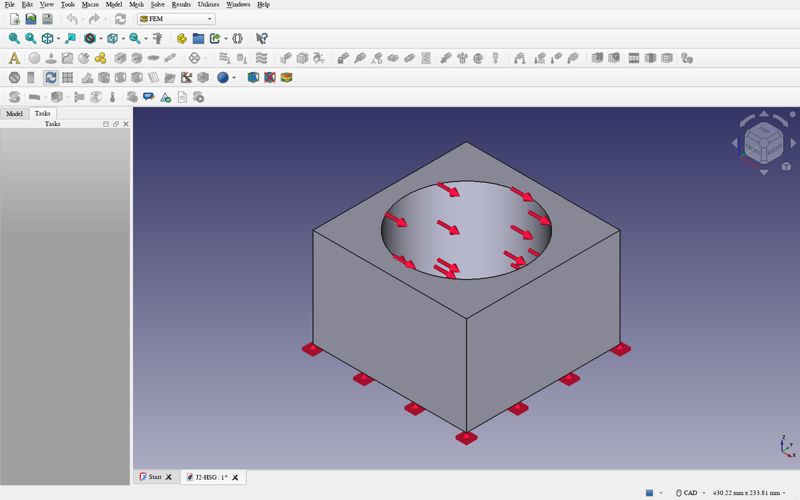
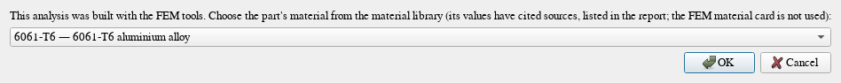
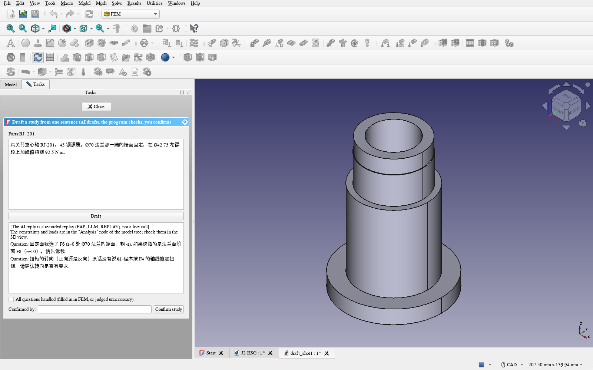
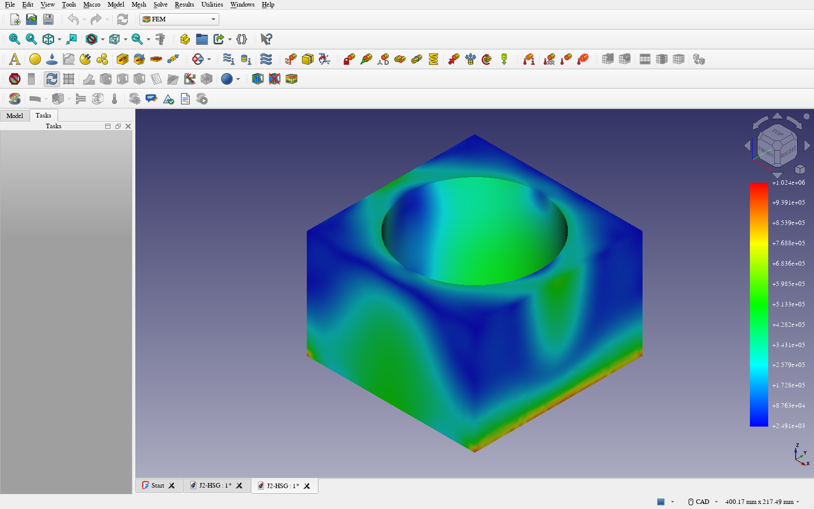
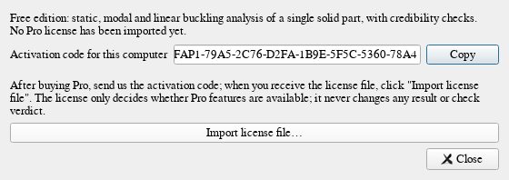

# What WenQuest FEA is

WenQuest FEA computes the strength, stiffness and natural frequencies of parts inside FreeCAD. The solver is CalculiX, the mesher is Gmsh, and pre- and post-processing use FreeCAD's FEM workbench. It adds three buttons to the FEM workbench:

- **Draft from one sentence (AI)**: describe the material, supports and loads in one sentence; AI drafts the constraints and loads, the program checks every item, and you confirm.
- **Compute and check**: every run includes a three-level mesh-convergence study, a reaction-balance check and a singularity check, and ends with an overall credibility verdict.
- **Report**: a Word / PDF report with a reviewer checklist and traceability data, in Chinese or English.

Three principles hold throughout:

1. **AI drafts; it never decides.** A study drafted by AI must be confirmed by an engineer before it can be solved. Every number in a report is filled in by the program; the AI-written "explanation and suggestions" may only quote numbers the program produced.
2. **Every run is checked.** Results that fail the checks get no safety factor, and the report says why.
3. **Data has sources.** Every value in the material library cites its source (GB/T, ASTM, handbooks); values without a source are not included.

Accuracy is documented in the *WenQuest FEA Verification Manual* installed with the software: 42 benchmark problems (cantilever, thick-walled cylinder, stress concentration at a hole, NAFEMS LE1 / LE10 / FV52, Euler column, Hertz contact, plasticity, large deformation, harmonic response and more), all within the stated tolerances.

# Installing and uninstalling

- System: Windows 10 / 11, 64-bit.
- Run `WenQuest-FEA-Setup-<version>.exe` and follow the prompts. The installer already contains FreeCAD 1.0.2, CalculiX, Gmsh and the Python components it needs; nothing else is required.
- The Start menu gets "WenQuest FEA", the verification manual (Chinese and English) and the license notices. On first start the program opens in the FEM workbench.
- To uninstall, use Windows Settings → Apps → WenQuest FEA. Your model files, results and license file are not in the installation folder and are kept.
- PDF reports need LibreOffice (free) on the computer; without it, reports are produced in Word format only.

# Free and Pro editions

| Feature | Free | Pro |
| --- | :---: | :---: |
| Static, modal and linear buckling analysis of a single solid part | ✓ | ✓ |
| Mesh-convergence, reaction-balance and singularity checks with a credibility verdict | ✓ | ✓ |
| Results in the FEM workbench (contour plots, deformation, clipping) | ✓ | ✓ |
| Thermal analysis, fatigue life | ✓ | ✓ |
| AI one-sentence drafting, AI explanation and suggestions | | ✓ |
| Formal report (Word / PDF, reviewer checklist, traceability) | | ✓ |
| Several parts: bonded, contact, bolt preload | | ✓ |
| Elastic-plastic material, large deformation | | ✓ |
| Harmonic response, random vibration, transient | | ✓ |
| Added mass, shells, beams, load combinations | | ✓ |
| Large models over 200,000 elements | | ✓ |

When the free edition reaches a Pro feature, it says which feature and how to enable it; it never produces a partial result. The license only decides whether Pro features are available; it never changes any result or check verdict.

# Where the commands are

- **Solve menu and toolbar** (in the FEM workbench, before "Run solver calculations"): Draft from one sentence (AI), Compute and check, Report; the menu also has "Thermal · fatigue".
- **Help menu** (before "About FreeCAD"): WenQuest FEA: License…; WenQuest FEA: AI key…; About WenQuest FEA.

The interface language follows FreeCAD (Edit → Preferences → General → Language). When you create a report you can choose its language separately, for example a Chinese interface with an English report.

# Way 1: build the analysis with the FEM tools (free edition)

For engineers who already use FreeCAD FEM. Getting-started example 1 (joint housing J2-HSG) follows these steps:

1. Open the part (File → Open, STEP or FreeCAD file) and switch to the FEM workbench.
2. Create an analysis container (Model → Analysis container) and add the CalculiX solver. Set the solver's analysis type to static, frequency (modal) or buckling.
3. Apply FEM's own constraints and loads to faces of the part: fixed, displacement, force, pressure and so on.
4. Click **Compute and check**. The first time, you choose a material from the material library (every value there cites its source, listed in the report; the FEM material card is not used).
5. The solve runs in the background and FreeCAD stays responsive. When it finishes you see the overall credibility verdict; results go into the analysis node, where FEM's result tools show contour plots, deformation and clipping.

A hand-built analysis can currently be taken over for a single solid part. For several parts, contact, bolts and so on, use drafting from one sentence (Pro).

# Way 2: draft from one sentence (Pro)

1. Select the part in the 3D view or the tree and click **Draft from one sentence (AI)**.
2. Write one sentence that says:
   - the part and its material ("45 steel, quenched and tempered", "6061-T6");
   - where it is fixed or how it is supported, using visible features ("the end face on the Ø70 flange end", "the two Ø12 bearing seats restrain radial motion only");
   - which loads act where, how large, in which direction ("a peak torque of 92.5 N·m on the Ø42.75 spline section", "2 kN vertically down");
   - what to compute (static by default; "also the first 4 natural frequencies", "buckling").
3. Click **Draft**. The program first recognizes the part's faces (cylinder diameters, plane positions and orientations); AI proposes constraints and loads from your sentence; the program checks every item: the faces exist, numbers and units come from your words, directions make sense. Proposals that fail are not used; they are listed with the reason.
4. Check the constraints and loads in the 3D view. Where AI is unsure it **asks** (for example "I chose F6 as the fixed face; tell me if you meant F8"). Fix or complete things in FEM, or decide nothing is needed, then tick "All questions handled".
5. Enter who confirms and click **Confirm study**. Unconfirmed studies cannot be solved.

The more specific the sentence, the fewer questions. Missing numbers (a load magnitude, say) are never invented; AI asks for them.

# Compute and check

After you click **Compute and check**, the software:

- solves on three meshes from coarse to fine and checks that the results converge;
- checks that the external loads balance the support reactions;
- checks whether the peak stress sits at a singularity caused by a sharp corner or point load (stress there grows without limit as the mesh is refined and cannot be used for judgement).

The overall credibility verdict is one of three:

- **Pass**: the results can be used to judge strength and stiffness; static results include a safety factor (based on the material's yield strength).
- **Fail**: the results are not credible and no safety factor is given; the message says which check failed and what to change (refine the mesh, change supports, avoid sharp corners).
- **Unknown**: data is missing, so no verdict is possible (for example the material has no yield strength). Missing data always gives "unknown", never "pass".

# Reports (Pro)

Click **Report**, then choose the report language, enter a report number (optional), revision and reason, and decide whether AI should write the "explanation and suggestions". The report contains the conclusions, the study and its basis (material sources, constraints and loads, mesh), the check results, contour plots, a reviewer checklist and traceability data (fingerprints of the study, the results and the part files).

- The Chinese and English reports contain exactly the same numbers and the same result fingerprint.
- The AI explanation is checked paragraph by paragraph: it may only quote numbers from the program, and a paragraph with anything that does not match is dropped; the report states which paragraphs were dropped and why.
- If the study was changed after solving, the software asks you to solve again before reporting.

Sample reports are in the folders of getting-started examples 2 and 3 (`sample-report.zh.pdf`, `sample-report.en.pdf`).

# Thermal analysis and fatigue

**Thermal · fatigue** in the Solve menu opens a window for:

- thermal analysis: pick a part, pick faces for thermal boundary conditions, and compute the temperature field and thermal stress on this computer;
- fatigue life: computed from the static result of the latest "Compute and check" and a load spectrum. Only for a single linear-elastic solid part, a single reference load, and a result whose credibility verdict is "pass".

# License

1. Help → **WenQuest FEA: License…** shows whether this is the free or Pro edition and the activation code of this computer.
2. After buying Pro, send us the activation code; when you receive the license file (`.json`), click **Import license file…**.
3. The license is checked offline. When it expires, the program returns to the free edition; existing models, results and reports are unaffected.

The license file is stored in your user folder at `.freecad-ai-parts\license.json`.

# AI key and your data

- One-sentence drafting and AI explanations need an API key for an AI service: DeepSeek in China, Claude elsewhere, switching automatically to the other on errors. Enter it under Help → **WenQuest FEA: AI key…**.
- The key is stored only in your user folder (`.freecad-ai-parts\.env`), never in the installation folder.
- Only your sentence and the list of part features recognized by the program (face numbers, types, sizes) are sent to the AI. **Model files are never sent.** Part models and results stay on your computer.
- Every report states which AI service and model were used.

# Frequently asked questions

**"Compute and check" says no constraint or load references a part yet.** Apply FEM's fixed, force, pressure and so on to faces of the part first.

**"This is a WenQuest FEA Pro feature".** The free edition explains which Pro features the study uses. Remove them, or import a Pro license.

**One-sentence drafting asks many questions.** Describe support and load locations by visible features (diameters, end faces, which side) and give every number with its unit.

**The credibility verdict is "fail".** Read the message: common causes are a coarse mesh, stress concentration at a point load or sharp corner, or insufficient supports. Change as suggested and solve again.

**Only a Word report, no PDF.** Install LibreOffice and create the report again.

**Results differ a lot from a hand calculation.** First read the credibility verdict and check notes, then compare with a similar problem in the verification manual. If in doubt, send us the FreeCAD file and the report.

# Verification and support

- The *WenQuest FEA Verification Manual* (Chinese and English) is in the Start menu. Every number in it was computed by running the tests of that software version.
- Results must be reviewed by a qualified engineer before use.
