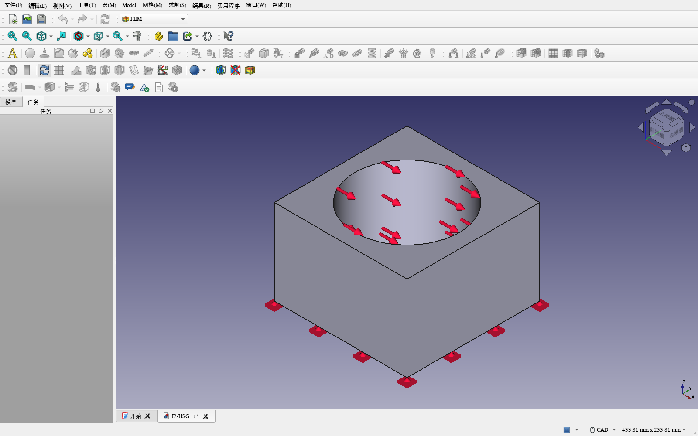
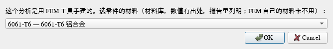
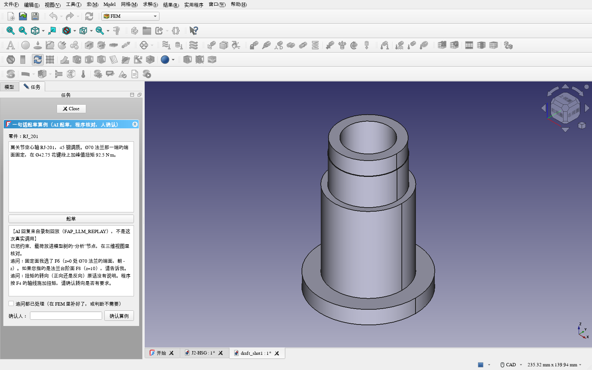
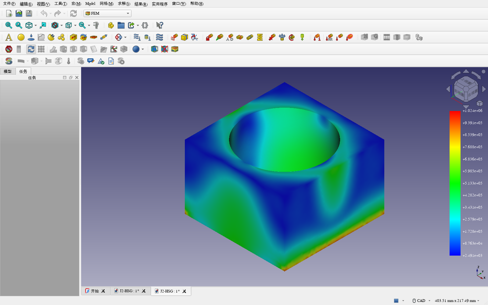
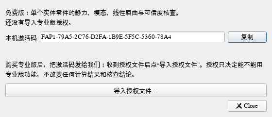

# 问渠有限元是什么

问渠有限元是装在 FreeCAD 里的零件强度、刚度和固有频率计算软件。求解器是 CalculiX，网格用 Gmsh，前处理和后处理用 FreeCAD 的 FEM 工作台。它在 FEM 工作台里加了三个按钮：

- **一句话起草（AI）**：用一句话说清材料、支承、载荷，AI 起草约束和载荷，程序逐项核对，你确认；
- **计算并核查**：计算的同时自动做三层网格收敛、反力平衡和奇异点核查，给出整体可信度结论；
- **出报告**：Word / PDF 报告，带审核清单和可追溯信息，可选中文或英文。

三条原则贯穿全部功能：

1. **AI 只起草，不判定。** AI 起草的算例要工程师确认后才能算；报告里的数字一律由程序填，AI 写的“解释与建议”只引用程序给出的数字。
2. **每次计算都核查。** 没通过核查的结果不给安全系数，报告里写明为什么。
3. **数据有出处。** 材料库里每个数值都注明出处（GB/T、ASTM、手册），对不上出处的不收。

计算的准确性见随软件安装的《问渠有限元验证手册》：42 道标准题（悬臂梁、厚壁圆筒、孔边应力集中、NAFEMS LE1 / LE10 / FV52、欧拉压杆、赫兹接触、塑性、大变形、谐响应等），全部在注明的误差内。

# 安装与卸载

- 系统：Windows 10 / 11，64 位。
- 运行安装包 `WenQuest-FEA-Setup-<版本>.exe`，按提示安装。安装包里已经带了 FreeCAD 1.0.2、CalculiX、Gmsh 和需要的 Python 组件，不需要另装。
- 安装后开始菜单里有“问渠有限元”、验证手册（中英）和许可证说明。第一次启动会直接进入 FEM 工作台。
- 卸载：Windows“设置 → 应用”里找到 WenQuest FEA 卸载。你的模型文件、计算结果和授权文件不在安装目录里，卸载不会删掉它们。
- 出 PDF 报告要本机装有 LibreOffice（免费）；没有时只出 Word 报告。

# 免费版和专业版

| 功能 | 免费版 | 专业版 |
| --- | :---: | :---: |
| 单个实体零件的静力、模态、线性屈曲 | ✓ | ✓ |
| 网格收敛、反力平衡、奇异点核查与可信度结论 | ✓ | ✓ |
| 结果在 FEM 工作台里看（云图、变形、剖切） | ✓ | ✓ |
| 热分析、疲劳寿命 | ✓ | ✓ |
| AI 一句话起草、AI 解释与建议 | | ✓ |
| 正式报告（Word / PDF，审核清单，可追溯信息） | | ✓ |
| 多个零件：绑定、接触、螺栓预紧 | | ✓ |
| 弹塑性、大变形 | | ✓ |
| 谐响应、随机振动、瞬态 | | ✓ |
| 附加质量、壳、梁、工况组合 | | ✓ |
| 超过 20 万单元的大模型 | | ✓ |

在免费版里点到专业版功能时，软件会说明是哪一项、怎么开通，不会出半截结果。授权只决定能不能用专业版功能，不改变任何计算结果和核查结论。

# 菜单在哪里

- **“求解”菜单和工具栏**（在 FEM 工作台里，“运行求解器”前面）：一句话起草（AI）、计算并核查、出报告；菜单里另有“热分析 · 疲劳”。
- **“帮助”菜单**（“关于 FreeCAD”前面）：问渠有限元：授权…；问渠有限元：设置 AI 密钥…；关于问渠有限元。

界面语言跟随 FreeCAD（编辑 → 首选项 → 常规 → 语言）。出报告时可以另选报告语言，比如界面中文、报告英文。

# 用法一：用 FEM 工具手建分析（免费版）

适合已经会用 FreeCAD FEM 的工程师。以入门例子 1（关节壳体 J2-HSG）为例：

1. 打开零件（文件 → 打开，STEP 或 FreeCAD 文件），切到 FEM 工作台。
2. 建分析容器（模型 → 分析容器），加 CalculiX 求解器。求解器的“分析类型”选 static（静力）、frequency（模态）或 buckling（屈曲）。
3. 用 FEM 自带的约束和载荷加在零件的面上：固定、位移、力、压力等。
4. 点 **计算并核查**。第一次会请你从材料库选材料（材料库里每个数值都有出处，报告里列明；FEM 自己的材料卡不用）。
5. 计算在后台进行，FreeCAD 不卡。算完弹出整体可信度结论，结果放进“分析”节点，用 FEM 的结果工具看云图、变形和剖切。

手建分析目前只接管单个实体零件。多个零件、接触、螺栓等请用一句话起草（专业版）。

# 用法二：一句话起草（专业版）

1. 在三维视图或模型树里选中要算的零件，点 **一句话起草（AI）**。
2. 写一句话，说清这几件事：
   - 零件和材料（如“45 钢调质”“6061-T6”）；
   - 哪里固定或怎么支承（用看得见的特征说：“Ø70 法兰那一端的端面”“两处 Ø12 轴承位只限制径向”）；
   - 哪里受什么载荷、多大、什么方向（“在 Ø42.75 花键段上加峰值扭矩 92.5 N·m”“竖直向下 2 kN”）；
   - 要算什么（静力是默认；“另算前 4 阶固有频率”“算屈曲”）。
3. 点 **起草**。程序先识别零件的面（圆柱面的直径、平面的位置和朝向），AI 按你的话提议约束和载荷，程序逐项核对：面找得到、数和单位出自原话、方向合理。核对不过的提议不采用，列出来并说明原因。
4. 看三维视图里的约束和载荷对不对。AI 拿不准的地方会**追问**（比如“固定面我选了 F6，如果指的是 F8 请告诉我”）。在 FEM 里补好或改好，或判断不需要，勾选“追问都已处理”。
5. 填确认人，点 **确认算例**。没确认的算例不能算。

写得越具体，追问越少。缺了的数（比如载荷大小）AI 不会编，会追问。

# 计算并核查

点 **计算并核查** 后，软件会：

- 自动划分三层由粗到细的网格计算，看结果随网格是否收敛；
- 核对外载与支承反力是否平衡；
- 查应力最大处是不是尖角、点载荷造成的奇异点（这种地方的应力会随网格无限增大，不能作为判定依据）。

整体可信度有三种结论：

- **通过**：可以据此判断强度、刚度；静力结果给出安全系数（按材料的屈服强度）。
- **不通过**：结果不可信，不给安全系数；提示里写明哪一项没通过、怎么改（加密网格、改支承、避开尖角）。
- **未知**：缺数据，没法判定（比如材料没有屈服强度）。缺数据时一律是“未知”，不会当成“通过”。

# 出报告（专业版）

点 **出报告**，依次选报告语言、填报告编号（可空）、版次和改版原因，再选要不要让 AI 写“解释与建议”。报告包括：结论、算例与依据（材料出处、约束和载荷、网格）、核查结果、云图、审核清单和可追溯信息（算例、结果、零件文件的指纹）。

- 中文报告和英文报告的每个数完全相同，结果指纹相同。
- AI 写的解释逐段核对：只能引用程序给出的数字，一段里有一处对不上，这一段就不用，报告里注明退回了哪段、为什么。
- 算例在计算后改过，软件会要求先重新计算再出报告。

报告样张见入门例子 2、3 目录下的 `sample-report.zh.pdf`、`sample-report.en.pdf`。

# 热分析与疲劳

“求解”菜单里的 **热分析 · 疲劳** 打开一个窗口：

- 热分析：选零件，选面加热边界，本机计算温度场和热应力；
- 疲劳寿命：按 FEM 分析里这次“计算并核查”的静力结果和载荷谱算。只对单个线弹性实体零件、单一参考载荷、核查结论为“通过”的结果计算。

# 授权

1. 帮助 → **问渠有限元：授权…**，看到现在是免费版还是专业版，以及本机激活码。
2. 购买专业版后，把激活码发给我们；收到授权文件（`.json`）后点 **导入授权文件…**。
3. 授权文件离线校验，不联网。到期后自动回到免费版，已有的模型、结果和报告不受影响。

授权文件保存在本机用户目录 `.freecad-ai-parts\license.json`。

# AI 密钥与数据

- 一句话起草和 AI 解释要用 AI 服务的密钥：中国用 DeepSeek，其他地方用 Claude，出错时自动换另一家。帮助 → **问渠有限元：设置 AI 密钥…** 填写。
- 密钥只存在本机用户目录（`.freecad-ai-parts\.env`），不进安装目录。
- 调用 AI 时只发送你写的那句话和程序识别出的零件特征清单（面的编号、类型、尺寸），**不发送模型文件**。零件模型和计算结果只在你的电脑上。
- 每份报告写明用的是哪家 AI、哪个模型。

# 常见问题

**点“计算并核查”提示“分析里还没有约束或载荷引用零件”。** 先用 FEM 的固定、力、压力等加在零件的面上。

**提示“这是问渠有限元专业版的功能”。** 免费版遇到专业版功能会这样说明，列出用到了哪些。去掉这些设置，或导入专业版授权。

**一句话起草追问很多。** 把支承和载荷的位置用看得见的特征说清楚（直径、端面、哪一侧），把数和单位写全。

**可信度“不通过”。** 看提示：常见原因是网格太粗、点载荷或尖角处的应力集中、支承不足。按提示改后重算。

**只出了 Word，没有 PDF。** 装 LibreOffice 后重新出报告。

**结果和手算差很多。** 先看可信度结论和核查说明，再对照验证手册里相近的标准题；仍有疑问请把 FreeCAD 文件和报告发给我们。

# 验证与支持

- 《问渠有限元验证手册》（中英两版）随软件安装在开始菜单里。每道题的数字都是那一版软件跑测试算出来的。
- 计算结果须由有资质的工程师审核后使用。
