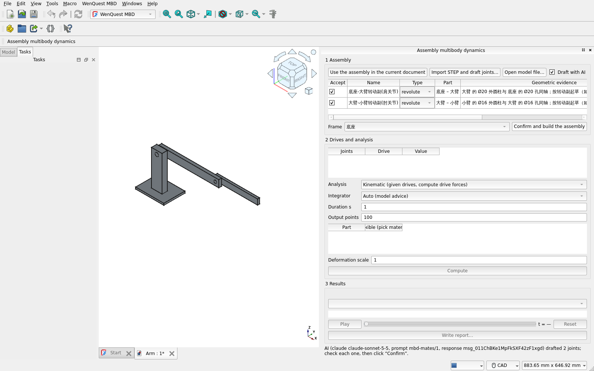
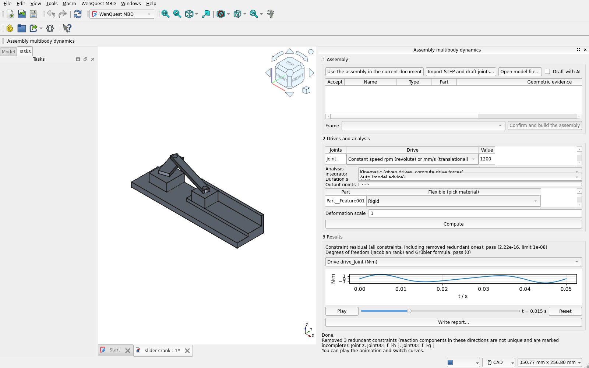
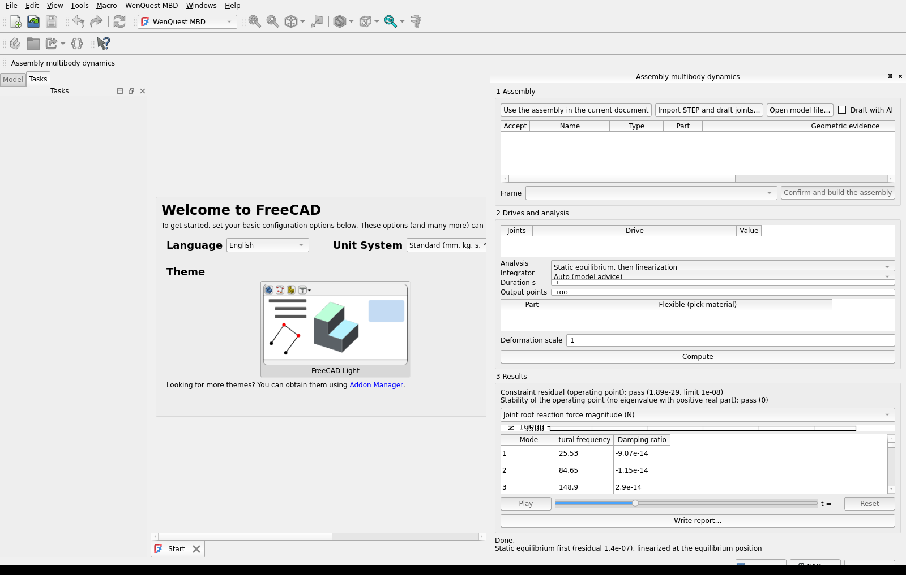
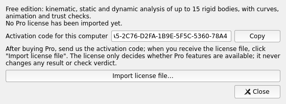

# What WenQuest MBD is

WenQuest MBD is mechanism motion and dynamics software that runs inside FreeCAD. Give it an assembly (a FreeCAD assembly or a STEP file) and it computes:

- how every part moves (position, velocity, acceleration), with an animation in FreeCAD;
- the torque or force each drive needs, for example the torque a motor must deliver;
- the force on every joint (pins, slides), for sizing bearings and checking pins;
- natural frequencies and mode shapes of the mechanism;
- deformation and stress of flexible parts, large deflection and buckling of slender rods.

Three principles run through everything:

1. **Compute straight from the assembly.** The program finds the joints from the geometry (coaxial shafts and holes, mating guide faces) and states the geometric evidence for each one; AI only helps select them, and you confirm.
2. **Every run is checked.** Constraint residual, degrees of freedom, energy conservation and stability of a linearization are each reported as pass / fail / not judged; failures are reported as they are.
3. **The program fills in the numbers.** Every number in a report traces back to the results; AI-written explanations may only cite numbers the program gives.

The accuracy is documented in the WenQuest MBD Verification Manual installed with the software: 44 benchmark problems with 74 compared values (simple pendulum, Andrews squeezing mechanism, slider-crank, Hertz impact, gear backlash, rotor whirl, elastica, buckling load and more), all within the stated tolerances.

# Installing and uninstalling

- System: Windows 10 / 11, 64-bit.
- Run `WenQuest-MBD-Setup-<version>.exe` and follow the prompts. FreeCAD 1.0.2, CalculiX, Gmsh and the Python components are included; nothing else to install.
- The Start menu gets WenQuest MBD, the user guide, the verification manual (Chinese and English), getting-started examples and the license notices. The first start opens the WenQuest MBD workbench.
- To uninstall, use Windows Settings > Apps > WenQuest MBD. Your models, results and license file are not in the installation folder and are kept.
- PDF reports need LibreOffice (free); without it you get the Word report only.

# Free and Pro

| Feature | Free | Pro |
| --- | :---: | :---: |
| Kinematics, statics and dynamics of rigid parts (up to 15 parts) | ✓ | ✓ |
| Joints drafted from the geometry; revolute, translational, cylindrical, spherical, universal, fixed | ✓ | ✓ |
| Constant-speed and displacement-function drives | ✓ | ✓ |
| Spring-dampers, torsion springs, bushings, constant and function forces | ✓ | ✓ |
| Curves, animation, trust checks | ✓ | ✓ |
| Unlimited number of parts | | ✓ |
| AI joint selection | | ✓ |
| Flexible parts: modal beams, solids (stress contours), large-deformation beams | | ✓ |
| Contact, friction, clearance, gear mesh, beam elements, actuators | | ✓ |
| Controllers: PID, state space, FMU co-simulation | | ✓ |
| HHT implicit integration; linearization and modes | | ✓ |
| Formal reports (Word / PDF, review checklist, traceability, AI explanation) | | ✓ |

When the free edition meets a Pro feature, it says which one and how to unlock it; it never produces partial results. The license only decides which features you can use; it never changes a result or a check.

# Where the commands are

The toolbar and the menu of the WenQuest MBD workbench:

- **Assembly multibody dynamics**: opens the calculation window (docked on the right);
- **License…**: shows whether you have Free or Pro, the activation code of this computer, and imports a license file;
- **Set AI key…**;
- **About WenQuest MBD**.

Build assemblies with FreeCAD's own Assembly workbench, or import a STEP file and let the program draft the joints. The interface language follows FreeCAD (Edit > Preferences > General > Language).

# Step 1: the assembly

Box 1 of the window offers three ways to start:

1. **Use the assembly in the current document**: an assembly built with the Assembly workbench (the `.FCStd` files of examples 1 and 2 are such assemblies).
2. **Import STEP and draft joints…**: the program reads the STEP file, finds candidate joints in the geometry and lists them:
   - a coaxial outer cylinder and hole: revolute (alternative: cylindrical);
   - a concentric ball and socket: spherical;
   - two or more pairs of mating planes with different normals: translational, along the only direction left free;
   - two or more shaft-hole fits on different axes: fixed.
   The evidence column says why. Untick the wrong ones, switch the type among the alternatives, choose the ground part (the one that does not move; by default the largest) and click "Confirm and build the assembly".
   With "Draft with AI" ticked (Pro), the AI only picks among these candidates, names them, chooses the ground part and gives reasons; it cannot invent joints or change their position or axis, and it says "please check" when unsure.
3. **Open model file…**: a JSON model in the `mbd-model/1` format (see "Model files"). Features without a control in the window, such as controllers, contact and large-deformation beams, are written in the model file.

Every part needs a material (part property ShapeMaterial, from the FreeCAD material library); mass, center of mass and inertia come from its density and the geometry. If a material is missing the window lists exactly what is missing; densities are never guessed.

# Step 2: drives and analysis

1. **Drives**: in the table, give a joint "constant speed" (rpm for revolute, mm/s for translational) or "displacement function" (degrees for revolute, mm for translational, `time` in s).
   Example: `60*(time - sin(2*pi*time)/(2*pi))` turns from 0 to 60° in 1 s with zero velocity and acceleration at both ends (cycloidal motion).
2. **Analysis**:
   - kinematic: with given drives, positions, velocities, the drive torques and the joint reactions (the drives must use up all degrees of freedom);
   - dynamic: free motion under gravity and force elements, or partly driven;
   - static equilibrium; static then dynamic;
   - linearization (modes); static then linearization (Pro).
3. **Integrator**: "automatic" by default: DOP853 (explicit, high order) for ordinary mechanisms, HHT (implicit) when there are flexible parts or beam elements. The status line says which one was used and why.
4. **Flexible parts** (Pro): choose a material in the "flexible" column and the part is reduced to a flexible solid (Gmsh mesh, CalculiX modes, with stresses), which takes tens of seconds to a few minutes. For a slender straight rod of constant section, choose "large-deformation beam: material"; the program measures the beam axis and section and computes large deflection, buckling and spin stiffening.
5. Click **Compute**. It runs in the background; FreeCAD stays responsive.

# Step 3: results

- **Trust checks**: constraint residual, degrees of freedom, energy conservation (without dissipation), stability (for linearization), each pass / fail / not judged.
- **Curves**: drive torques, joint reaction forces and moments, part positions, measures, contact forces, kinetic energy; pick from the list.
- **Mode table**: natural frequencies and damping ratios after a linearization.
- **Animation**: drag the slider or press Play; flexible parts are drawn as meshes colored by von Mises stress (blue low, red high). Reset puts the parts back.

# Reports (Pro)

Click **Write report…** and choose a folder. You get:

- the formal report `report.docx` (plus `report.pdf` with LibreOffice installed), in eight sections: summary, model, trust checks, results, AI explanation, limitations, review checklist, traceability; with prepared / reviewed / approved boxes for signatures;
- `model.json`, `result.json`, the source ledger `report.ledger.json` and the revision record `report.record.json`.

The report language follows the interface language. Chinese and English reports have exactly the same numbers and the same result fingerprint. With "Draft with AI" ticked, the AI writes the explanation paragraphs, but the program fills in every number: a paragraph that states its own numbers or judgements such as "safe" or "acceptable" is rejected, and the report says so. The header reads "Draft, to be reviewed by an engineer".

Sample reports are in the three example folders (`sample-report.zh.pdf`, `sample-report.en.pdf`).

# Model files

Everything the window can do can be written in a model file, and features without a control in the window (controllers, contact, gears, beam elements, large-deformation beams, measures) are written there; then use "Open model file…" to compute, view results and write reports. The format is JSON `mbd-model/1`:

| Content | Field |
| --- | --- |
| Bodies | `bodies`: mass, center of mass and inertia for rigid bodies; `flex` for flexible ones (modal beam, solid, large-deformation beam) |
| Joints | `joints`: fixed, revolute, translational, cylindrical, spherical, universal; optional friction, clearance on revolute joints |
| Drives | `motions`: constant speed or displacement function |
| Force elements | `forces`: forces and torques, spring-dampers, torsion springs, bushings, beams, gear mesh, actuators |
| Contact | `geometries`, `contacts` |
| Control | `controllers`: PID, state space, FMU |
| Analysis | `analysis`: type, duration, output steps, integrator, `load_steps` (load stepping for large-deformation statics) |

The `pushrod-*.json` files of example 3 are model files you can adapt. When a model file is opened, the window takes the analysis type, duration, output steps and integrator from the file; change them to compute differently.

# License

1. Menu **WenQuest MBD > License…** shows whether you have Free or Pro and the activation code of this computer.
2. After buying Pro, send us the activation code; when you receive the license file (`.json`), click **Import license file…**.
3. The license is checked offline. When it expires you are back on Free; your models, results and reports are unaffected. One license file can enable both WenQuest FEA and WenQuest MBD.

# AI key and data

- AI joint selection and AI explanations need an AI service key: DeepSeek in China, Claude elsewhere, switching to the other on errors. Enter it under **Set AI key…**.
- The key is stored only in your user folder, not in the installation folder.
- Only part names, volumes and the candidate joints found by the program, or a summary of the results, are sent to the AI, **never the model files**. Assemblies and results stay on your computer.

# Getting-started examples

Three examples are in the `examples` folder of the installation (Start menu: Getting-started examples):

1. **Slider-crank (Free)**: import `slider-crank.step`; the program drafts three revolute joints and one translational joint; steel; crank at 1200 rpm; kinematics give the crank drive torque and the reaction at every pin.
2. **Two-joint arm (Pro)**: import `arm.step`; the AI picks the shoulder and elbow joints; the shoulder turns 60° and the elbow −90° in 1 s; the two joint motor torques (peaks 1.79 N·m and 0.25 N·m); Chinese and English reports.
3. **Slender pushrod buckling (Pro, model files)**: a pinned-pinned steel rod φ20 × 1000 mm under different compressive loads, static then linearization; the square of the first bending frequency falls linearly with the load, and its zero gives the buckling load, about 0.4 % from Euler's formula.

Each folder has a description (`README.md`), a results summary (`results.json`) and sample reports in Chinese and English.

# FAQ

**"Cannot compute yet: … material".** Give every part a material (part property ShapeMaterial), then click "Use the assembly in the current document" again.

**"This is a WenQuest MBD Pro feature".** The free edition lists the Pro features in use. Remove them or import a Pro license.

**"Kinematic analysis needs 0 degrees of freedom (… DOF remain after adding drives)".** Kinematics need drives that use up all degrees of freedom; use dynamics, or drive the remaining joints.

**Constraint residual "fail".** Usually joint axes that are not parallel or positions that are off (an over-constrained spatial loop); check the assembly, or change a revolute joint to a spherical or cylindrical one.

**Slow computation.** Stiff systems with flexible parts or beam elements use the HHT integrator ("automatic" picks it); very many output steps also slow things down.

**Only Word, no PDF.** Install LibreOffice and write the report again.

# Verification and support

- The WenQuest MBD Verification Manual (Chinese and English) is in the Start menu. Every number in it was computed by running the tests of that version of the software.
- Results must be reviewed by a qualified engineer before use.
