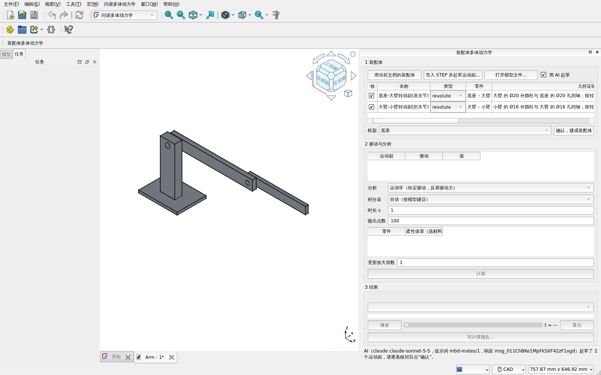
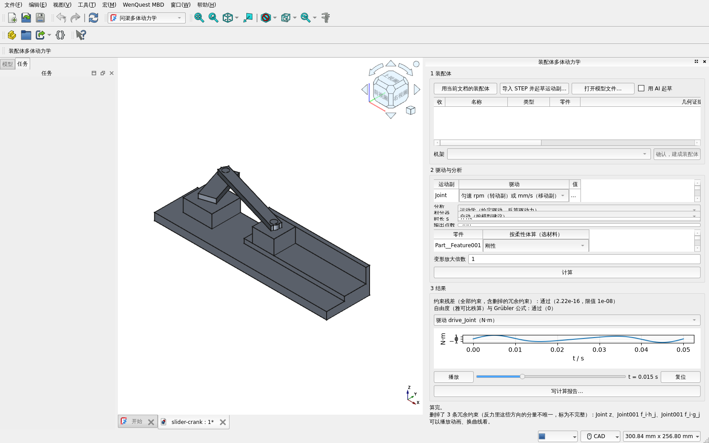
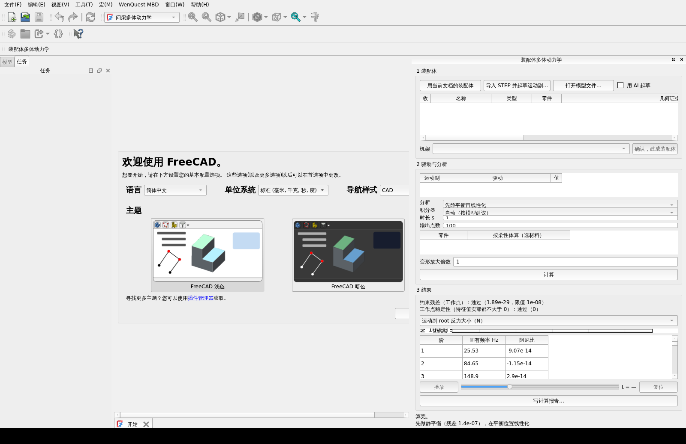
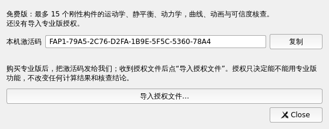

# 问渠多体动力学是什么

问渠多体动力学是装在 FreeCAD 里的机构运动和动力计算软件。你给它一个装配体（FreeCAD 的装配体，或者一个 STEP 文件），它算出：

- 每个零件怎么动（位置、速度、加速度），并在 FreeCAD 里放动画；
- 驱动要多大的力矩或力，比如电机要多大扭矩；
- 每个运动副（铰链、导轨）受多大的力，用来选轴承、校核销轴；
- 机构的固有频率和振型；
- 柔性零件的变形和应力，细长杆的大挠度和屈曲。

三条原则贯穿全部功能：

1. **装配体直接算。** 运动副由程序从几何里找（同轴的轴和孔、贴合的导轨面），每一个都写明几何证据；AI 只帮着挑，最后由你确认。
2. **每次计算都核查。** 约束残差、自由度、能量守恒、线性化的稳定性，逐条写“通过 / 不通过 / 不判”；没通过的照实写出来。
3. **数字由程序填。** 报告里的每个数都能追到计算结果；AI 写的解释只能引用程序给出的数字。

计算的准确性见随软件安装的《问渠多体动力学验证手册》：44 道标准题、74 项对照（单摆、Andrews 挤压机构、曲柄滑块、赫兹碰撞、齿轮侧隙、转子涡动、弹性线、屈曲载荷等），全部在注明的误差内。

# 安装与卸载

- 系统：Windows 10 / 11，64 位。
- 运行安装包 `WenQuest-MBD-Setup-<版本>.exe`，按提示安装。安装包里已经带了 FreeCAD 1.0.2、CalculiX、Gmsh 和需要的 Python 组件，不需要另装。
- 安装后开始菜单里有“问渠多体动力学”、用户手册、验证手册（中英）、入门例子和许可证说明。第一次启动会直接进入“问渠多体动力学”工作台。
- 卸载：Windows“设置 → 应用”里找到 WenQuest MBD 卸载。你的模型文件、计算结果和授权文件不在安装目录里，卸载不会删掉它们。
- 出 PDF 报告要本机装有 LibreOffice（免费）；没有时只出 Word 报告。

# 免费版和专业版

| 功能 | 免费版 | 专业版 |
| --- | :---: | :---: |
| 刚性零件的运动学、静平衡、动力学（最多 15 个零件） | ✓ | ✓ |
| 程序按几何起草运动副；转动、移动、圆柱、球、万向、固定 | ✓ | ✓ |
| 匀速驱动、位移函数驱动 | ✓ | ✓ |
| 弹簧阻尼、扭簧、衬套、恒力、函数力 | ✓ | ✓ |
| 曲线、动画、可信度核查 | ✓ | ✓ |
| 零件数不限 | | ✓ |
| AI 帮着挑运动副 | | ✓ |
| 柔性零件：模态梁、实体（应力云图）、大变形梁 | | ✓ |
| 接触、摩擦、间隙、齿轮啮合、梁元件、执行器 | | ✓ |
| 控制器：PID、状态空间、FMU 联合仿真 | | ✓ |
| HHT 隐式积分；线性化与模态 | | ✓ |
| 正式报告（Word / PDF，审核清单，可追溯信息，AI 解释） | | ✓ |

在免费版里用到专业版功能时，软件会说明是哪一项、怎么开通，不会出半截结果。授权只决定能不能用专业版功能，不改变任何计算结果和核查结论。

# 菜单在哪里

“问渠多体动力学”工作台的工具栏和同名菜单：

- **装配体多体动力学**：打开计算窗口（停在 FreeCAD 右边）；
- **授权…**：看现在是免费版还是专业版，本机激活码，导入授权文件；
- **设置 AI 密钥…**；
- **关于问渠多体动力学**。

装配体用 FreeCAD 自带的 Assembly 工作台建；也可以直接导入 STEP，让程序起草。界面语言跟随 FreeCAD（编辑 → 首选项 → 常规 → 语言）。

# 第一步：装配体

窗口第 1 栏有三种开始方式：

1. **用当前文档的装配体**：FreeCAD 里已经用 Assembly 工作台建好的装配体（入门例子 1、2 的 `.FCStd` 文件就是）。
2. **导入 STEP 并起草运动副…**：程序读入 STEP，从几何里找候选运动副，列在表里：
   - 同轴的外圆柱与孔 → 转动副（备选圆柱副）；
   - 同心的球与球窝 → 球副；
   - 两组以上法向不同的贴合平面 → 移动副，方向是唯一能滑的方向；
   - 两条以上不同轴线的轴孔配合 → 固定。
   “几何证据”一栏写着凭什么。勾掉不对的，类型可以在备选里换；选机架（不动的零件，缺省是体积最大的），点“确认，建成装配体”。
   勾“用 AI 起草”（专业版）时，AI 只在这些候选里挑、起名字、选机架、写理由，不能新造运动副，也不能改位置和方向；拿不准的会写“请核对”。
3. **打开模型文件…**：`mbd-model/1` 格式的 JSON 模型（见“模型文件”一节）。控制器、接触、大变形梁等窗口里没有入口的功能写在模型文件里。

每个零件都要有材料（零件属性 ShapeMaterial，从 FreeCAD 材料库选），程序按材料密度和几何算质量、质心、惯量。缺材料时窗口逐条列出缺什么，不估密度。

# 第二步：驱动与分析

1. **驱动**：在表里给要驱动的运动副选“匀速”（转动副填 rpm，移动副填 mm/s）或“位移函数”（转动副是角度 °，移动副是 mm，`time` 是时间 s）。
   例：`60*(time - sin(2*pi*time)/(2*pi))` 是 1 s 内从 0 转到 60°、起止速度和加速度都为零（摆线规律）。
2. **分析**：
   - 运动学：给定驱动，算位置、速度和驱动要的力矩、运动副反力（自由度要被驱动用完）；
   - 动力学：受重力、力元自由运动，或部分驱动；
   - 静平衡；先静平衡再动力学；
   - 线性化（模态）；先静平衡再线性化（专业版）。
3. **积分器**：缺省“自动”——一般机构用 DOP853（显式高阶），有柔性零件、梁元件时用 HHT（隐式），计算完状态栏写明用了哪个、为什么。
4. **柔性零件**（专业版）：在“按柔性体算”一栏给零件选材料，程序把零件缩减成实体柔性体（gmsh 划网格、CalculiX 算模态，带应力），几十秒到几分钟；
   细长的等截面直杆可以选“大变形梁：材料”，程序自动量梁轴、截面，算大挠度、屈曲和旋转刚化。
5. 点 **计算**，在后台算，不卡界面。

# 第三步：结果

- **核查结论**：约束残差、自由度、能量守恒（无耗散时）、稳定性（线性化时），每条写“通过 / 不通过 / 不判”。
- **曲线**：驱动力矩、运动副反力和反力矩、零件质心位置、测量量、接触力、动能，在下拉框里选。
- **模态表**：线性化时列出各阶固有频率和阻尼比。
- **动画**：拖滑块或点“播放”；柔性零件画成网格，颜色是 von Mises 应力（蓝低红高）。点“复位”零件回原位。

# 出报告（专业版）

点 **写计算报告…**，选文件夹。得到：

- 正式报告 `report.docx`（装了 LibreOffice 时另有 `report.pdf`），八节：结论摘要、模型、可信度核查、结果、AI 解释、局限、审核清单、可追溯信息；编制、审核、批准三栏留给人签字；
- `model.json`、`result.json`，出处账 `report.ledger.json`，改版记录 `report.record.json`。

报告语言同界面语言；中文报告和英文报告的每个数完全相同，结果指纹相同。勾了“用 AI 起草”时 AI 写解释段落，但数字一律由程序填：AI 自己写了数字、写“合格 / 安全”之类的判断，那一段就退回不用，报告里注明。报告页眉写着“草稿，须工程师审核”。

报告样张见三个入门例子目录下的 `sample-report.zh.pdf`、`sample-report.en.pdf`。

# 模型文件

窗口能做的，模型文件都能写；窗口里没有入口的功能（控制器、接触、齿轮、梁元件、大变形梁、测量量）写在模型文件里，再用“打开模型文件…”计算、看结果、出报告。格式是 `mbd-model/1` 的 JSON，主要几部分：

| 内容 | 字段 |
| --- | --- |
| 构件 | `bodies`：刚体给质量、质心、惯量；柔性体给 `flex`（模态梁、实体、大变形梁） |
| 运动副 | `joints`：固定、转动、移动、圆柱、球、万向；可加摩擦，转动副可加间隙 |
| 驱动 | `motions`：匀速或位移函数 |
| 力元 | `forces`：力与力矩、弹簧阻尼、扭簧、衬套、梁、齿轮啮合、执行器 |
| 接触 | `geometries`、`contacts` |
| 控制 | `controllers`：PID、状态空间、FMU |
| 分析 | `analysis`：类型、时长、输出点数、积分器、`load_steps`（大变形静力分几步加） |

入门例子 3 的 `pushrod-*.json` 就是模型文件，可以照着改。打开模型文件时，窗口里的分析类型、时长、输出点数、积分器照文件填好，改了就按改的算。

# 授权

1. 菜单 **问渠多体动力学 → 授权…**，看到现在是免费版还是专业版，以及本机激活码。
2. 购买专业版后，把激活码发给我们；收到授权文件（`.json`）后点 **导入授权文件…**。
3. 授权文件离线校验，不联网。到期后自动回到免费版，已有的模型、结果和报告不受影响。一个授权文件可以同时开问渠有限元和问渠多体动力学。

# AI 密钥与数据

- AI 帮着挑运动副和 AI 解释要用 AI 服务的密钥：中国用 DeepSeek，其他地方用 Claude，出错时自动换另一家。菜单 **设置 AI 密钥…** 填写。
- 密钥只存在本机用户目录，不进安装目录。
- 调用 AI 时只发送零件名称、体积和程序找出的候选运动副清单，或计算结果的摘要，**不发送模型文件**。装配体和计算结果只在你的电脑上。

# 入门例子

安装目录的 `examples` 里有三个例子（开始菜单“入门例子”）：

1. **曲柄滑块（免费版）**：导入 `slider-crank.step`，程序起草 3 个转动副和 1 个移动副，给钢材，曲柄 1200 rpm，算运动学，看曲柄要的驱动力矩和各铰链的反力。
2. **两关节机械臂（专业版）**：导入 `arm.step`，AI 挑出肩、肘两个关节；肩关节 1 s 转 60°、肘关节转 −90°，算两个关节电机要的力矩（峰值 1.79 N·m、0.25 N·m），出中英报告。
3. **细长推杆屈曲（专业版，模型文件）**：两端铰支的钢杆 φ20 × 1000 mm，在不同压力下先静平衡再线性化，一阶弯曲频率的平方随压力线性下降，外推到零频率就是屈曲载荷，与欧拉公式相差约 0.4 %。

每个例子目录里有说明（`README.md`）、结果摘要（`results.json`）和中英报告样张。

# 常见问题

**提示“还不能计算：…材料”。** 给每个零件设材料（零件属性 ShapeMaterial）后，点“用当前文档的装配体”重新读。

**提示“这是问渠多体动力学专业版的功能”。** 免费版遇到专业版功能会这样说明，列出用到了哪些。去掉这些设置，或导入专业版授权。

**提示“运动学分析要自由度为 0（加了驱动以后还剩 … 个自由度）”。** 运动学要驱动把自由度全部用完；改用动力学，或给剩下的运动副加驱动。

**约束残差“不通过”。** 常见原因是运动副的轴线不平行、位置有偏差（空间闭环过约束）；检查装配，或把某个转动副改成球副、圆柱副。

**算得很慢。** 有柔性零件、梁元件的硬系统用 HHT 积分器（“自动”会选）；输出点数太多也会慢。

**只出了 Word，没有 PDF。** 装 LibreOffice 后重新出报告。

# 验证与支持

- 《问渠多体动力学验证手册》（中英两版）随软件安装在开始菜单里。每道题的数字都是那一版软件跑测试算出来的。
- 计算结果须由有资质的工程师审核后使用。
