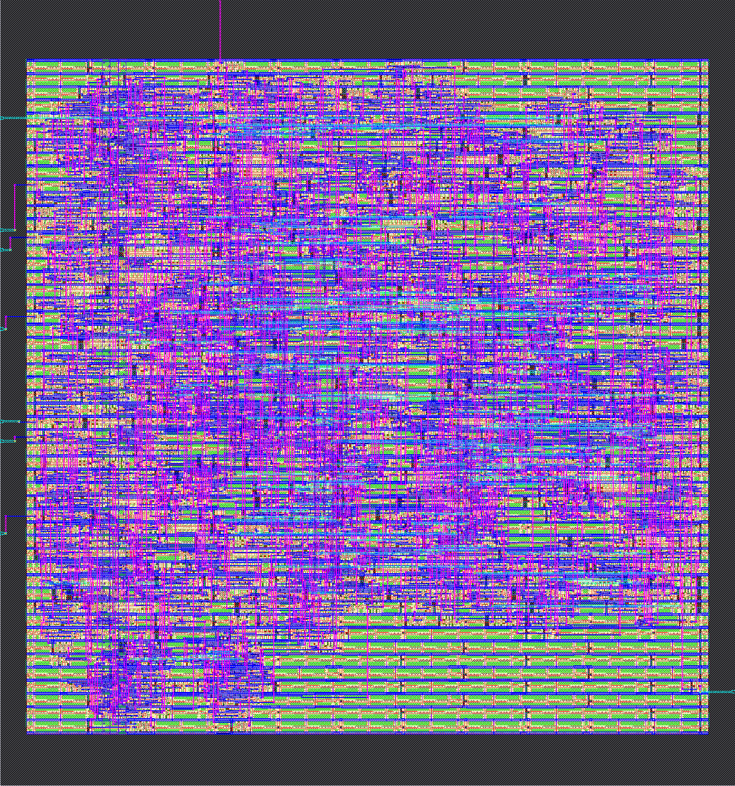

# 综合与版图（LibreLane，CI 工作流 `chip.yml`）

| 项目 | 结果 |
|---|---|
| 芯片面积 | 24,534 μm²（151 × 162 μm） |
| 标准单元 | 1316 个（其中触发器 153），利用率 62% |
| 时序余量（建立 / 保持） | 5.06 / 0.12 ns（50 MHz 周期 20 ns） |
| 设计规则（布线 / Magic / KLayout） | 0 / 0 / 0 |
| 版图与原理图一致（LVS） | 错误 0 |
| 天线效应 | 0 |
| 最大转换时间违例 | 204（多在输入输出端口的缓冲上，待优化，不影响功能仿真） |
| 功耗（{DJ['clock_mhz']} MHz） | 1.21 mW |

产物：GDS 版图 `wq_encif.gds`、门级网表 `wq_encif.nl.v`、时序约束 `wq_encif.sdc`（`factory/designs/wq-encif/out/layout/`）。
芯片面积主要是逻辑；封装后的尺寸由焊盘和 QFN-16 决定。最大转换时间违例 204 处是实话——开源流程跑通了，但离“可以流片”还差这一项的优化。
