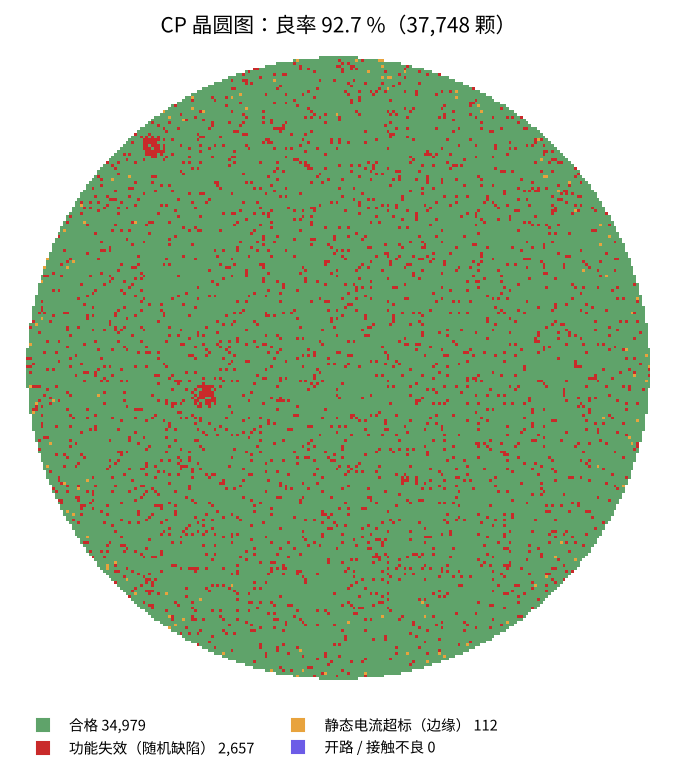

# 制造：一片晶圆 → 一批芯片

芯片封测厂仿真车间：晶圆测试 3.4 小时、封装测试 28 小时。

| 特性 | 公差 | 这一批 |  |
|---|---|---|---|
| CP 良率（按晶圆图） | 85–100 | 92.67 % | ✓ |
| 探针接触电阻（各测试位平均） | 0–3 | 1 Ω | ✓ |
| 静态电流 IDDQ（中位数） | 0–10 | 1.034 µA | ✓ |
| 施密特上阈值 VT+（中位数，第 93 轮仿真 1.254 V） | 1.1–1.4 | 1.231 V | ✓ |
| 施密特下阈值 VT−（中位数，第 93 轮仿真 0.607 V） | 0.45–0.75 | 0.5849 V | ✓ |
| 划片崩边（抽检最大值） | 0–25 | 12.11 µm | ✓ |
| 键合拉力（抽检最小值） | 3–12 | 6.387 gf | ✓ |
| 焊球推力（抽检平均） | 15–40 | 25.61 gf | ✓ |
| 塑封空洞率（X 光抽检） | 0–3 | 0.7102 % | ✓ |
| FT 良率 | 95–100 | 98.35 % | ✓ |
| 工作电流（50 MHz，中位数；第 92 轮版图约 0.67 mA） | 0.4–1 | 0.6911 mA | ✓ |
| 施密特回差（中位数；第 93 轮仿真 0.648 V） | 0.45–0.85 | 0.6297 V | ✓ |

CP 合格 34,979 颗 × FT 良率 98.4 % ≈ **34,403 只成品**，编带 12 盘，整批卖给电路板厂（驱动板 B 版）。
晶圆图上红点（有几处成簇）是随机缺陷，靠边缘的零星黄点是静态电流超标——**看图比看良率一个数字多知道“坏在哪、为什么坏”**（芯片厂实验 38）。
