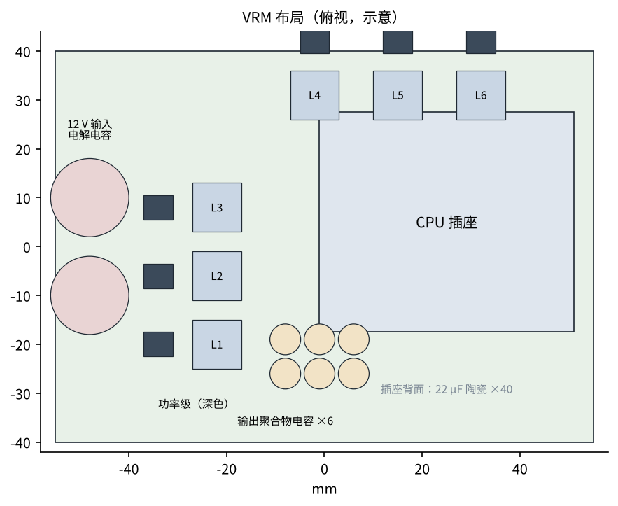
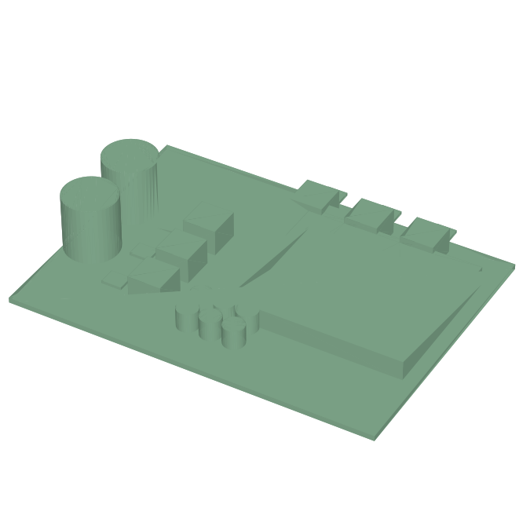

# 三维与布局：插座左侧 3 相、上方 3 相

布局要点：

1. **功率级 → 电感 → 插座**一条直线，大电流回路最短；12 V 输入陶瓷电容贴着每颗功率级的输入脚（开关时的高频电流就在这一小圈里转）。
2. 输出聚合物电容放插座边上，22 μF 陶瓷电容放**插座正背面**（离 CPU 最近，第 4 步的 ESL 按这个算）。
3. 功率级底部焊盘打满过孔到内层地，140 A 时每颗 2.25 W 靠主板铜皮和上面的散热片散。
4. 电压采样线从插座背面的采样点差分引回控制器（远端采样），不和大电流共用铜。

## 用到的问渠零件库零件

| 零件库编号 | 名称 | 规格 | 主要尺寸（mm，零件库） | 用在 |
|---|---|---|---|---|
| `A-ELE-C1206/10U-25V` | 贴片陶瓷电容 1206 | 10U-25V |  | 12 V 输入（每相 2 只，共 12 只） |
| `A-ELE-CPEL/470U-63V` | 贴片铝电解电容 | 470U-63V | d 16，h 17.5 | 12 V 输入电解（2 只） |
| `A-ELE-C0402/100N` | 贴片陶瓷电容 0402 | 100N |  | 控制器、功率级去耦 |

外购件（示例参数，型号待确认）：智能功率级 ×6（导通电阻 5 / 1.2 mΩ，带电流输出）、多相数字控制器 ×1、150 nH 电感 ×6（DCR 0.2 mΩ）、
560 μF 2.5 V 聚合物电容 ×6、22 μF 0805 陶瓷电容 ×40。三维模型 `5_VRM布局.step`（示意尺寸）。
