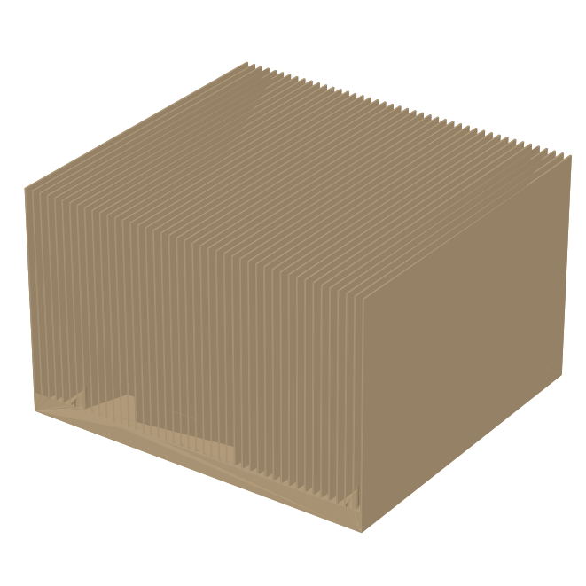
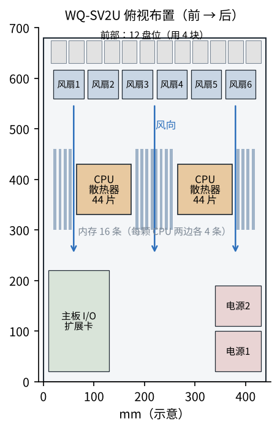

# 三维与图纸

**散热器 HS-SV**：紫铜底板 108 × 100 × 6 mm + 0.5 mm 凸台；6061 铝鳍片 44 片 × 0.5 mm、高 62 mm、
间距 2.50 mm（钎焊在底板上）；四角 Ø3.4 孔，弹簧螺钉固定。三维模型 `5_散热器.step`。

整机布置：前面硬盘 → 一排 6 只风扇 → 两颗 CPU 并排（导风罩隔开，每颗 20 % 风量）、两边内存 → 后面电源、I/O。两颗 CPU **并排**而不是一前一后，后面那颗就不吃前面那颗的热风。

## 用到的问渠零件库零件

| 零件库编号 | 名称 | 规格 | 主要尺寸（mm，零件库） | 用在 |
|---|---|---|---|---|
| `A-SCR-SHC/M3x16` | 内六角圆柱头螺钉 | M3x16 | d 3，P 0.5，l 16，dk 5.68，k 3，s 2.5，t 1.3 | 散热器弹簧螺钉的螺钉（每颗 CPU 4 只，对角顺序拧紧） |

外购件（示例参数，型号待确认）：散热器 HS-SV ×2（按上面图纸外协钎焊）、60 mm 高速风扇 FAN-SV ×6、导热硅脂。
