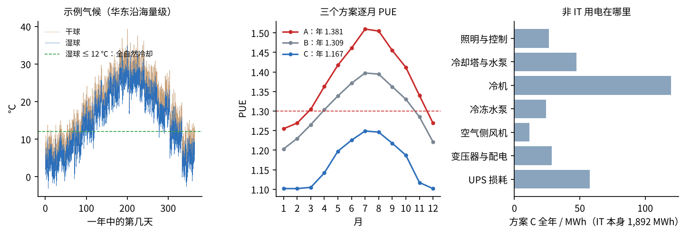

# 仿真：全年逐时 PUE + 可用性

## 1 全年 8760 小时（三个方案同一套气候、同一个负荷 216 kW）

逐时：UPS 效率随负载率、变压器与配电 1.5 %、空气侧风机、冷冻水泵、冷机（COP = 卡诺 × 0.35（风冷直膨）/ 0.55（水冷离心），冷凝温度跟干球或湿球走）、冷却塔与冷却水泵、照明；
方案 C 湿球 ≤ 12 ℃ 时冷却塔经板换直接出 18 ℃ 水（冷机停），往上 5 K 部分预冷。

| 方案 | 年 PUE | 年用电 | 全自然冷却 | 部分自然冷却 | 最热小时总用电 |
|---|---|---|---|---|---|
| A 房间精密空调（风冷直膨） | 1.381 | 2,612 MWh | 0 h | 0 h | 351 kW |
| B 冷冻水 7/12 ℃ + 房间空调 | 1.309 | 2,477 MWh | 214 h | 1,350 h | 316 kW |
| C 背门换热器 + 18/24 ℃ 温水 + 自然冷却 | 1.167 | 2,207 MWh | 3,450 h | 1,397 h | 283 kW |

方案 C 比 A 一年少用 **405 MWh**。最热的 7 月 PUE 1.249，最冷的 1 月 1.102（自然冷却 100 %）。

## 2 可用性：N+1 设备组（MTBF / MTTR 示例值）

每组“n 台里至少 k 台好的”：公式 A = Σ C(n,j)·a^j·(1−a)^(n−j)，a = MTBF/(MTBF + MTTR)；蒙特卡洛按逐次故障、修理的马尔可夫链每组模拟两百万年。

| 设备组 | 配置 | MTBF / MTTR | 年停机（公式） | 年停机（蒙特卡洛） | 不冗余时（n = k） |
|---|---|---|---|---|---|
| UPS 模块 | 4 选 3 | 200,000 h / 8 h | 0.005 min | 0.006 min | 63 min |
| 冷机 | 3 选 2 | 25,000 h / 24 h | 1.449 min | 1.454 min | 1008 min |
| 冷冻水泵 | 3 选 2 | 50,000 h / 12 h | 0.091 min | 0.089 min | 252 min |
| 冷却塔 | 3 选 2 | 40,000 h / 24 h | 0.567 min | 0.543 min | 630 min |
| 柴油发电机（停电时） | 2 选 1 | 2,500 h / 24 h | 0.043 min | 0.044 min | 5 min |

合计年停机：公式 2.16 分钟、蒙特卡洛 2.14 分钟（相差 0.9 %）；**可用性 99.9996 %**。
如果都不冗余，年停机 32.6 小时、可用性 99.628 %——N+1 是必须的。（市电由 UPS + 发电机接住；配电、管路按双路 / 环路不算单点。）
