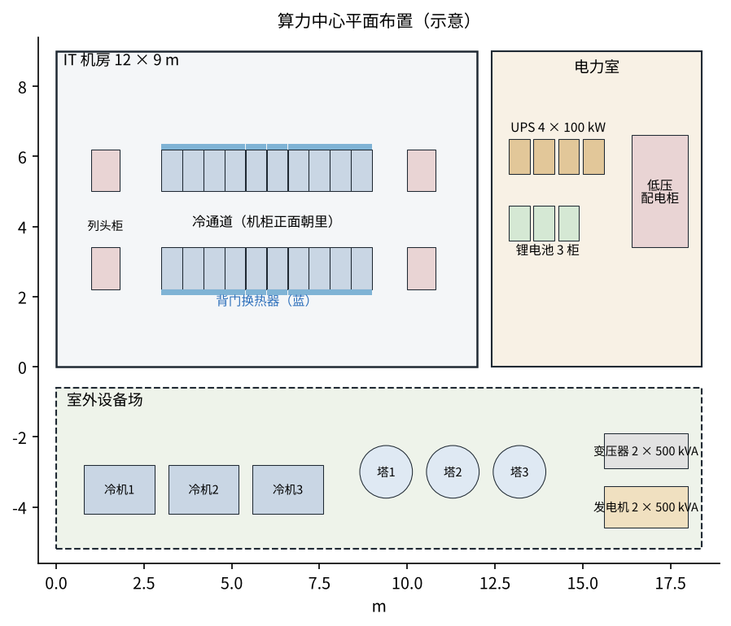
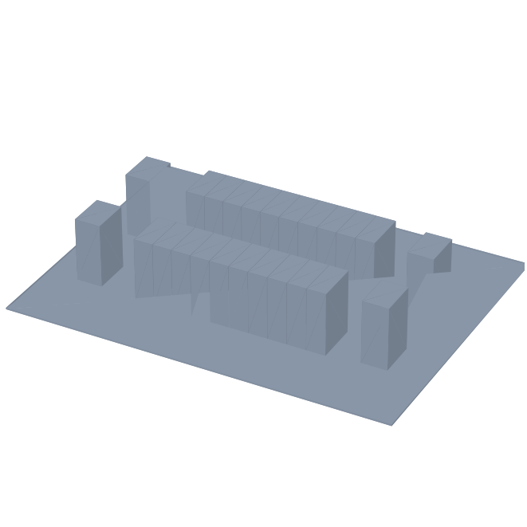

# 三维与平面图

- **IT 机房 12 × 9 m**：两排各 10 柜，正面朝中间冷通道（1.6 m），后面是背门换热器和检修通道；两头是列头柜（每排两台，两路供电）。
  背门换热器让机房基本“热中性”，不用封冷 / 热通道；房间里只留两台小空调除湿。
- **温水管**走架空地板下，环形布置（任意一段坏了可以从另一头供水），每柜一对软管快接头 + 关断阀 + 漏水检测绳。
- **电力室**：UPS、锂电池、低压配电；**室外**：2+1 台冷机、2+1 台冷却塔、板式换热器（自然冷却）、2 台变压器、2 台柴油发电机。

三维模型 `5_机房.step`（机柜、背门换热器、列头柜，示意尺寸）。
