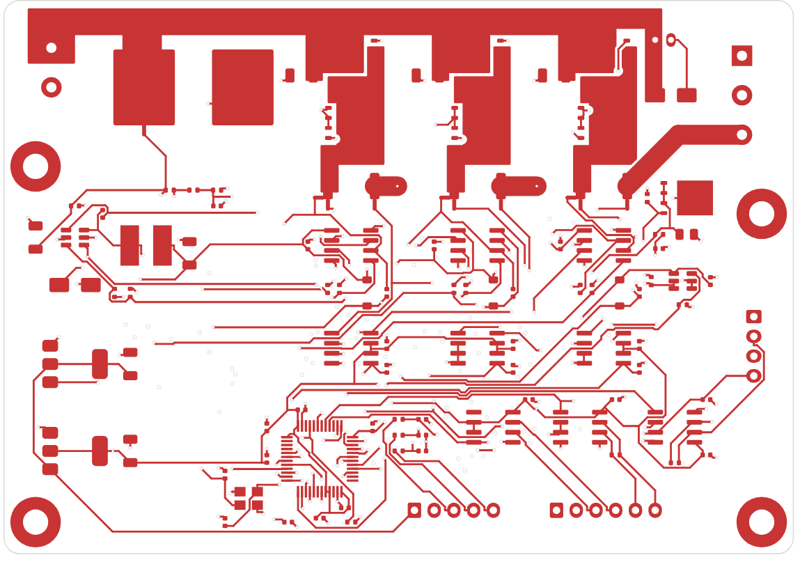

# 布局：开尔文接法和放大器位置

驱动板 B 版（`factory/designs/drv-joint-b`，KiCad 工程由设计描述生成、自动布线）顶层铜：

采样电阻 R21–R23（2512）串在三相输出上，相电流几十安培从电阻的大焊盘流过；**放大器的两根输入线从电阻焊盘内侧单独引出（开尔文接法）**，
不和大电流共用一段铜——否则焊盘和走线那几毫欧也被量进去（2 mΩ 的电阻，多 0.2 mΩ 的铜就是 10 % 误差）。其余要点：

1. 两根输入线并排走、等长，远离开关节点（相输出、栅极驱动）。
2. 放大器靠近采样电阻，输出到 ADC 的线可以长一点（低阻抗、已放大）；ADC 前 RC 靠近 MCU。
3. 放大器去耦 `A-ELE-C0402/100N` 贴着电源脚。
4. 采样电阻焊盘下面多打散热过孔到内层，额定 143 mW 的热要散掉，电阻温度高了阻值会变。

| 零件库编号 | 名称 | 规格 | 主要尺寸（mm，零件库） | 用在 |
|---|---|---|---|---|
| `A-ELE-SHUNT/2M` | 采样电阻 2512 | 2M |  | R21–R23（三相各一只） |
| `A-ELE-SOIC8/INA240A1D` | SOIC-8 芯片 | INA240A1D |  | U 三只（三相各一只） |
| `A-ELE-LQFP48/STM32G431CBT6` | LQFP-48 微控制器 | STM32G431CBT6 |  | ADC |
| `A-ELE-C0402/1N` | 贴片陶瓷电容 0402 | 1N |  | ADC 前 RC |
| `A-ELE-C0402/100N` | 贴片陶瓷电容 0402 | 100N |  | 去耦 |
