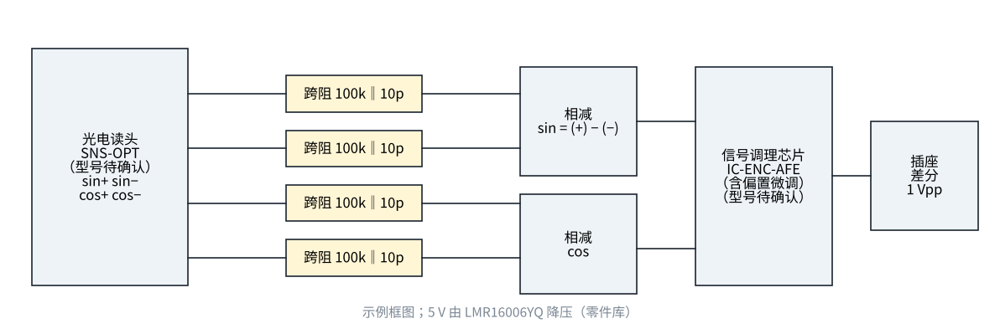

# 原理图（框图）与布局要点

| 零件库编号 | 名称 | 规格 | 主要尺寸（mm，零件库） | 用在 |
|---|---|---|---|---|
| `A-ELE-R0402/100K` | 贴片电阻 0402 | 100K |  | 跨阻 ×4 |
| `A-ELE-C0402/10P` | 贴片陶瓷电容 0402 | 10P |  | 跨阻并联 ×4 |
| `A-ELE-C0402/100N` | 贴片陶瓷电容 0402 | 100N |  | 去耦 |
| `A-ELE-SOT/LMR16006YQ` | SOT 封装稳压芯片 | LMR16006YQ |  | 5 V 电源 |
| `A-ELE-XH/6P` | 线对板连接器（2.5 mm） | 6P | pitch 2.5 | 输出插座（sin±、cos±、5 V、地） |

**布局要点**（跨阻放大器的输入是几微安、几百千欧——最怕漏电和耦合）：

1. 光电读头紧贴跨阻放大器，输入线越短越好；输入节点四周铺**保护环**（接参考电压），挡住板面漏电流。
2. 四路完全对称布线（对称才能相减抵消）：sin+ 与 sin−、cos+ 与 cos− 镜像摆放。
3. 降压电源的开关节点远离输入，放在板子另一端，底层铺地隔开。
4. 三防涂覆前彻底清洗：助焊剂残留在 100 kΩ 节点上就是漏电。

> 读头板还没有 KiCad 工程（驱动板、控制器有）；本案例到框图和布局要点为止，KiCad 工程按驱动板的设计描述方式以后补（第 161f 轮细则偏差 D-1）。
