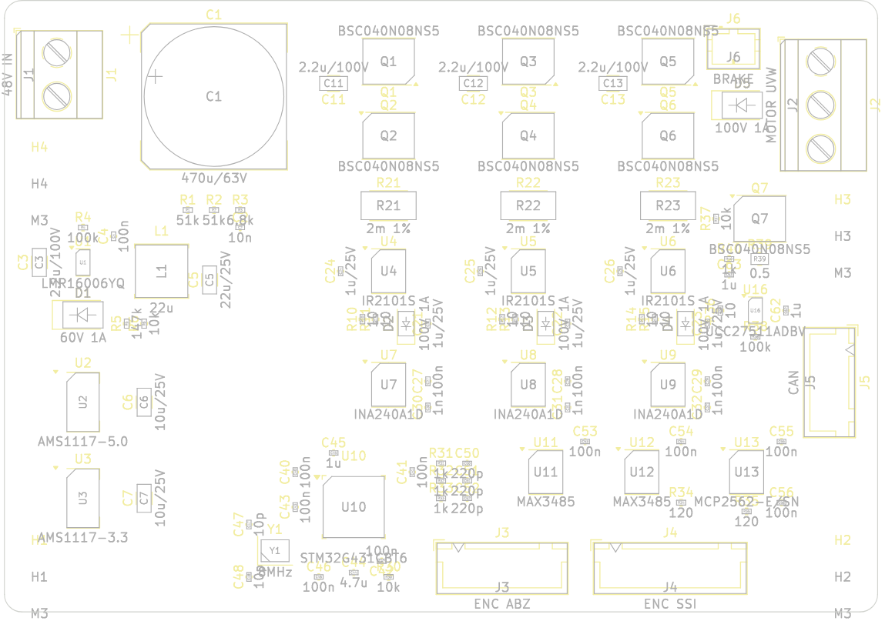

# 原理图、PCB 与检查（KiCad 产物，`factory/designs/drv-joint-b/out/`）

| 产物 | |
|---|---|
| 原理图 | 8 页 SVG（每个功能块一页），KiCad 工程 `kicad-project.zip` |
| PCB | 100 × 70 mm、4 层，Freerouting 自动布线；Gerber、坐标文件 `pos.csv` |
| 三维 | `drv-joint-b.step`、`drv-joint-b.glb`（板形与安装孔；元件三维在“电路板设计”页看） |
| 物料清单 | 46 行、108 个元件（`bom.csv`） |
| 电气规则检查（DRC） | 错误 **0**、未连接 **0**、警告 111（丝印重叠一类） |
| 可制造性（DFM，对照电路板厂工艺能力） | 10 项检查，全部通过（下表） |

| 可制造性检查 | 本板 | 板厂能力 |  |
|---|---|---|---|
| 最细线宽 | 0.25 mm | 0.127 mm | ✓ |
| 最小线距（铜到铜） | 0.127 mm | 0.127 mm | ✓ |
| 最小孔径 | 0.3 mm | 0.3 mm | ✓ |
| 最小孔环 | 0.15 mm | 0.15 mm | ✓ |
| 最小阻焊桥 | 0.175 mm | 0.1 mm | ✓ |
| 元件到板边 | 0.79 mm | 0.5 mm | ✓ |
| 元件外框不重叠 | 0 处 | 0 处 | ✓ |
| 极性元件方向统一 | 6 个 | 6 个 | ✓ |
| ICT 测试点覆盖率 | 0.965  | 0.9  | ✓ |
| 大电流走线宽度 | 7 条网络 | 7 条网络 | ✓ |

**零件库里的主要器件**（设计描述的器件取自 KiCad 官方库，零件库电子元件第一批就是从这块板导进来的，第 88 轮）：

| 零件库编号 | 名称 | 规格 | 主要尺寸（mm，零件库） | 用在 |
|---|---|---|---|---|
| `A-ELE-LQFP48/STM32G431CBT6` | LQFP-48 微控制器 | STM32G431CBT6 |  |  |
| `A-ELE-SOIC8/IR2101S` | SOIC-8 芯片 | IR2101S |  |  |
| `A-ELE-SOIC8/INA240A1D` | SOIC-8 芯片 | INA240A1D |  |  |
| `A-ELE-SOIC8/MCP2562-E-SN` | SOIC-8 芯片 | MCP2562-E-SN |  |  |
| `A-ELE-SOIC8/MAX3485` | SOIC-8 芯片 | MAX3485 |  |  |
| `A-ELE-SOT/LMR16006YQ` | SOT 封装稳压芯片 | LMR16006YQ |  |  |
| `A-ELE-SHUNT/2M` | 采样电阻 2512 | 2M |  |  |
| `A-ELE-MOSTDSON/BSC040N08NS5` | 功率 MOSFET（TDSON-8） | BSC040N08NS5 |  |  |
