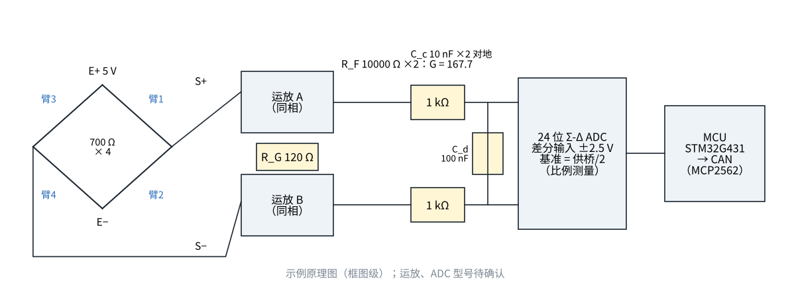

# 原理图与元件清单

## 用到的零件库元件

| 零件库编号 | 名称 | 规格 | 主要尺寸（mm，零件库） | 用在 |
|---|---|---|---|---|
| `A-ELE-R0402/10K` | 贴片电阻 0402 | 10K |  | R_F ×2（前置级反馈） |
| `A-ELE-R0402/120R` | 贴片电阻 0402 | 120R |  | R_G ×1（定增益 167.7） |
| `A-ELE-R0402/1K` | 贴片电阻 0402 | 1K |  | 抗混叠 R ×2 |
| `A-ELE-C0402/100N` | 贴片陶瓷电容 0402 | 100N |  | 差分电容 C_d ×1；电源去耦 ×6 |
| `A-ELE-C0402/10N` | 贴片陶瓷电容 0402 | 10N |  | 共模电容 C_c ×2 |
| `A-ELE-SOT/AMS1117-5.0` | SOT 封装稳压芯片 | AMS1117-5.0 |  | 5 V 稳压（供桥 + 模拟电源） |
| `A-ELE-LQFP48/STM32G431CBT6` | LQFP-48 微控制器 | STM32G431CBT6 |  | 读 ADC、温度补偿表、CAN 输出 |
| `A-ELE-SOIC8/MCP2562-E-SN` | SOIC-8 芯片 | MCP2562-E-SN |  | CAN 收发器 |
| `A-ELE-XH/5P` | 线对板连接器（2.5 mm） | 5P | pitch 2.5 | 电桥插座（E+、E−、S+、S−、屏蔽） |
| `A-ELE-XH/4P` | 线对板连接器（2.5 mm） | 4P | pitch 2.5 | 输出插座（电源、CAN） |

## 零件库里没有的（写通用类型，型号待确认）

| 位号 | 类型 | 要求 |
|---|---|---|
| U1 | 双路零漂移精密运放 | 输入噪声 ≤ 10 nV/√Hz、失调漂移 ≤ 0.05 μV/℃、轨到轨输出 |
| U2 | 24 位 Σ-Δ ADC | 差分输入、外部基准、≥ 1 kSPS、50/60 Hz 陷波可关 |
| — | 0.1 % 低温漂电阻（基准分压） | 25 ppm/℃ |

零件库 0402 电阻都是 1 % 的：做增益、滤波够用（误差标定掉），做方案 ② 的差分级不够——这是第 4 步仿真的结论。
