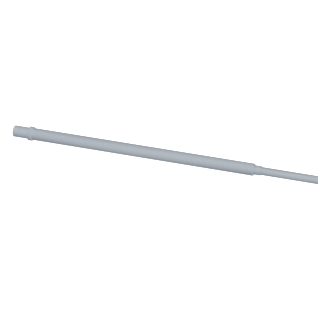

# 三维与图纸：上轴 D 版

轴段（x 为沿轴位置，机针 x = 0，单位 mm；`tools/wqls/spec.py` 的 UPPER_SEGS）：

| x | 直径 | 装什么 |
|---|---|---|
| 20…32 | Ø15 | 针杆曲柄座（夹紧） |
| 32…43 | Ø15 | 前轴承位 6202 |
| 43…48 | Ø19 | 轴肩 |
| 48…375 | Ø16 | 轴身（送布偏心、同步带轮） |
| 375…385 | Ø12 | 后轴承位 6201 |
| 385…472 | Ø10 | 电机转子、手轮 |

全长 452 mm；台阶圆角 R0.5（受轴承内圈倒角限制）；轴颈 k5、磨削；曲柄座铣紧固平面（相位基准）。
三维模型 `5_LS-101.step`（按上表轴段，不含平面、键槽细节）。
