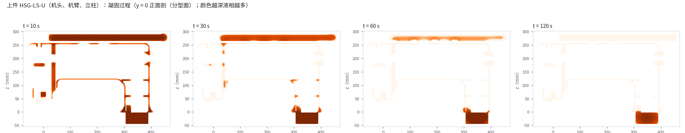

# 仿真

## 一转干涉检查（G4）

全部零件装在机壳里，主轴每 4° 一帧转一圈（90 帧），105 对零件逐帧量最小间隙：
最小 **1.00 mm**（要求 ≥ 1 mm），太近的 0 对。

## 机壳铸造凝固（G5）

上件浇注 1380 ℃，铸件 16.0 kg、浇注 24.8 kg（工艺出品率 64.5 %），全部凝固 322 s；
按凝固顺序设冒口，最后凝固的地方在冒口里。

